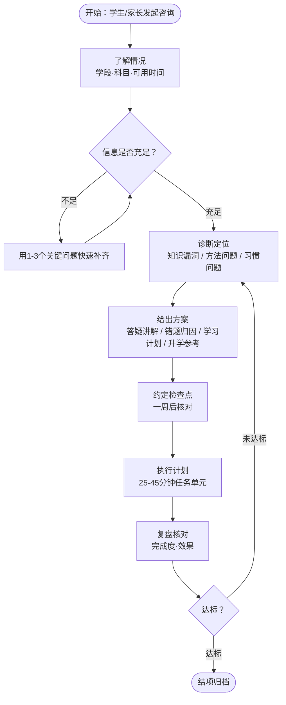
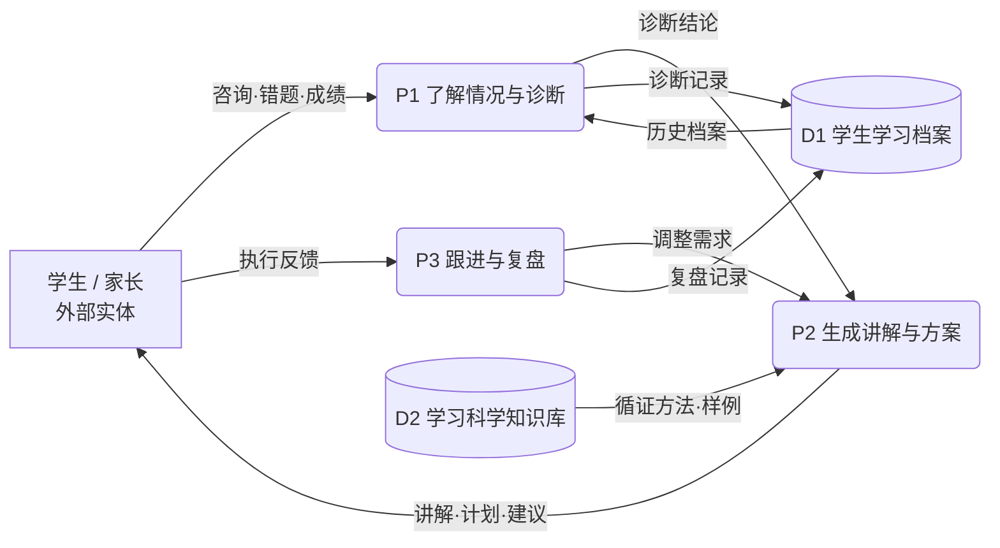

# 业务流程分析作业

- **学号**：2503408070
- **姓名**：张力文
- **日期**：2026 年 11 月 6 日
- **课程**：信息系统分析与设计（第 6 章 流程建模）

---

## 一、研究对象说明

本次业务流程分析的研究对象是 **「启航·学业导师」专家（学习规划与学科辅导专家）**。该专家面向学生与家长，提供学科答疑、错题归因分析、个性化学习计划制定与升学路径参考等服务，内置 learning-science 学习科学知识底座。下图为本次分析时与该专家的对话记录：

*图 0　研究对象——「启航·学业导师」专家*

---

## 二、业务流程图

*图 1　「启航·学业导师」业务流程图（含判断分支与"未达标"回环）*

---

## 三、业务流程分析需要回答的问题

| # | 教材问题 | 针对研究对象的回答 |
|---|---------|------------------|
| 1 | 有哪些业务流程？各自目的或想达到的目标是什么？ | 4 条主流程：① 学科答疑（理解知识、掌握思路）② 错题归因分析（定位真正薄弱点）③ 个性化学习计划制定（把目标拆解为可执行任务）④ 升学路径参考（理清决策要素）；另有 1 条贯穿的**跟进复盘流程**，目的是让学习进入良性循环 |
| 2 | 这个业务流程是如何完成的？有哪些任务并经过哪些步骤？活动执行（开始、结束）的条件？ | 以"学习计划"流程为例：开始条件 = 学生给出学段、科目、目标、可用时间；步骤 = 收集信息 → 诊断当前水平 → 拆解周计划与日任务（25-45 分钟/单元）→ 按遗忘曲线排复习节点（1/3/7/15 天）→ 输出计划表；结束条件 = 计划输出且学生确认可执行 |
| 3 | 这个业务流程有谁参与？各自完成流程中的哪些活动？ | 学生（提供情况、执行任务、反馈效果）、家长（补充信息、监督、决策）、导师专家（诊断、出方案、组织复盘）、知识底座 learning-science（提供循证方法与分学段书单） |
| 4 | 流程中有哪些控制流？多个不同流程之间有什么关系？ | 判断分支：信息不足 → 追问 1-3 个关键问题；心理压力明显 → 先关注状态、缓谈学业；复盘未达标 → 回到"诊断定位"调整方案。流程之间是**上下游依赖**：诊断结论是方案生成的输入，复盘结果触发计划修订 |
| 5 | 流程用了哪些方式或手段来完成？ | 引导式提问（不直接给答案）、错题四类归因法（知识性错误 / 审题偏差 / 计算书写失误 / 方法思路缺失）、主动回忆 + 间隔重复、交错练习、表格化计划清单、约定每周检查点 |
| 6 | 完成任务所用的资源及其成本如何？流程各环节的增值作用如何？ | 知识资源（学习科学方法库、分学段科普书单）+ 学生时间成本（每任务 25-45 分钟）。增值体现为每环节都有可检查产出：诊断 → 诊断结论；计划 → 计划表；复盘 → 调整依据；全程用数据说话、不作"保证提分"的绝对化承诺 |
| 7 | 流程中是否存在瓶颈或阻塞排队现象？ | 三个潜在瓶颈：① 信息不足导致反复追问（用 1-3 个关键问题快速补齐）② 计划过载导致执行中断（预留弹性与休息时间）③ 学生不反馈导致复盘空转（约定检查点强制闭环） |

---

## 四、数据流图（DFD，顶层）

*图 2　「启航·学业导师」顶层数据流图（依据"分解与抽象"思想，P1-P3 可继续逐层向下分解）*

---

## 五、数据流分析需要回答的问题

| # | 教材问题 | 针对研究对象的回答 |
|---|---------|------------------|
| 1 | 系统作为信息处理器主要完成什么功能？最重要的输入和输出数据是什么？ | 功能：接收学习问题与执行反馈，输出诊断结论、讲解、计划与调整建议。最重要输入 = 错题/成绩/可用时间；最重要输出 = 诊断结论 + 个性化学习计划 |
| 2 | 系统作为一个整体，和外部环境存在什么关系？ | 输入端：学生/家长的咨询、错题、执行反馈；输出端：讲解、计划、建议。系统边界（不做的事）：不代写作业、不作绝对化提分承诺 |
| 3 | 系统功能复杂，是否能分解为几个相对独立的又有联系的子系统或子功能？ | 能，分解为 3 个加工：P1 了解诊断、P2 方案生成、P3 跟进复盘，靠"诊断结论"和"调整需求"两条数据流相互联系 |
| 4 | 分解后的子功能是否仍然复杂、还可划分为更细更具体的子功能吗？ | 能：P2 可再分为答疑讲解、错题归因、计划排布、书单推荐 4 个更具体的子功能——即"自顶向下、逐层分解" |
| 5 | 每个功能或子功能的输入数据和输出数据是什么？ | P1：输入咨询·错题·成绩 → 输出诊断结论；P2：输入诊断结论 + D2 循证方法 → 输出讲解·计划·建议；P3：输入执行反馈 → 输出调整需求与复盘记录 |
| 6 | 系统中需要长期保存的数据有哪些？这些数据如何创建、修改和使用？ | D1 学生学习档案（诊断记录、计划完成度、错题本）：首次诊断时创建，每次复盘时追加/修改，制定新计划时读取（"历史档案"流）；D2 学习科学知识库：预置方法库，只读 |
| 7 | 在一个业务流程中，数据来源到去处是否完整？ | 完整：输入的每份错题/反馈都有去处（诊断记录 → 方案 → 复盘记录），D1 的档案也被 P1 再读取使用，不存在"有去无回"或悬空的数据流 |

---

## 六、事件类型的寻找（拓展）

按教材"事件的类型"对照研究对象：

| 事件类型 | 对应「启航·学业导师」的事件 |
|---------|--------------------------|
| 外部事件（external event） | 学生/家长发起咨询、提交错题、教师发布成绩 |
| 时间事件（temporal event） | 每周复盘检查点、遗忘曲线 1/3/7/15 天复习提醒 |
| 状态事件（state event） | 计划连续未完成自动触发方案调整、同类错题反复出现触发专项练习 |
