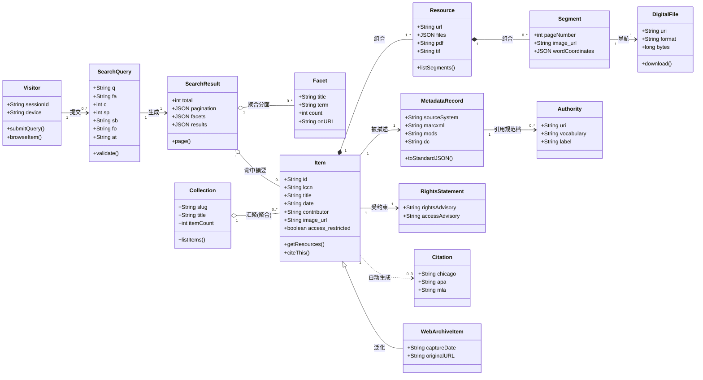
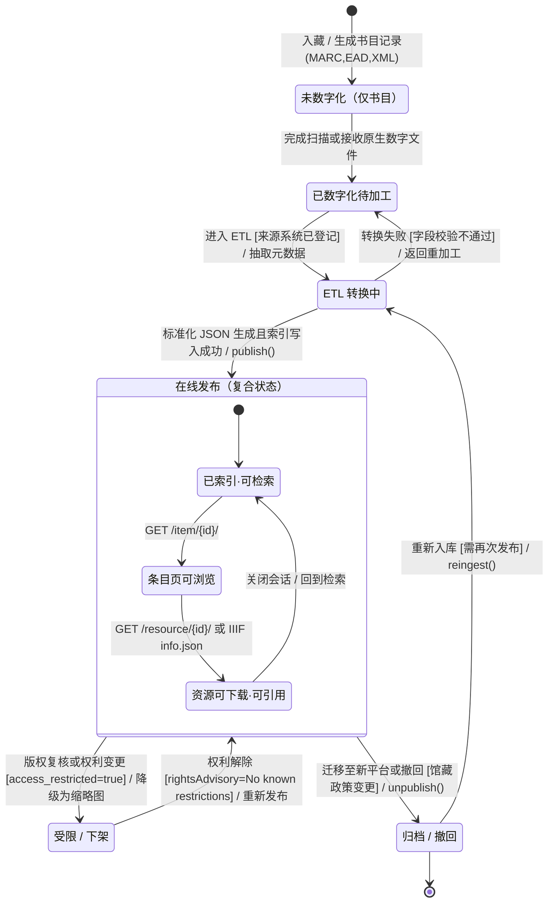
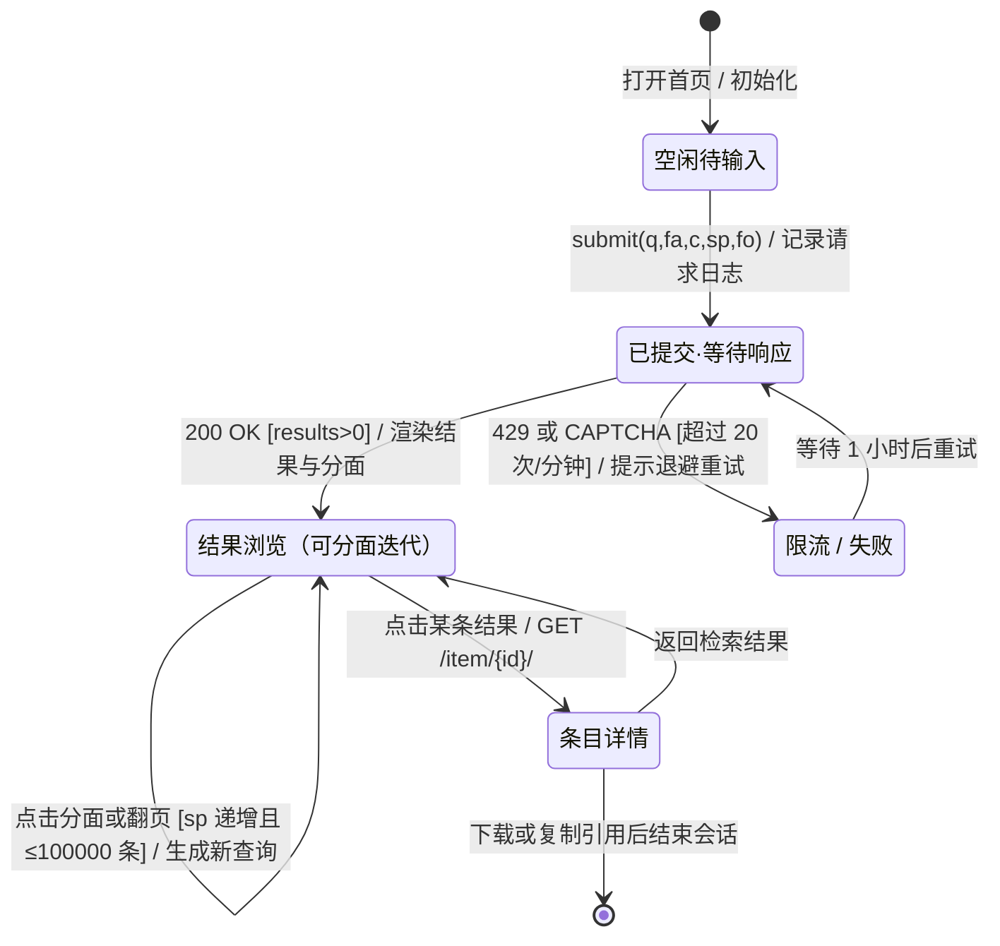
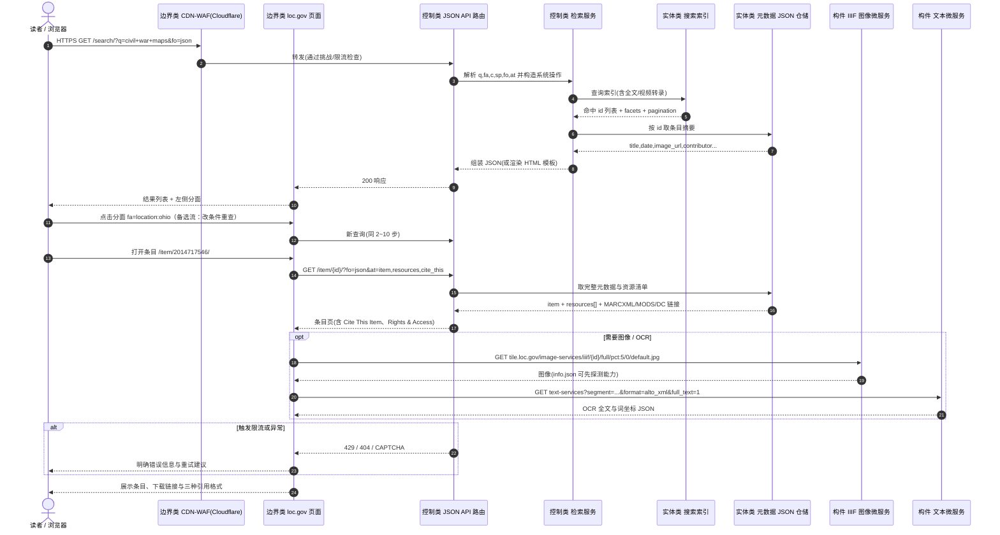
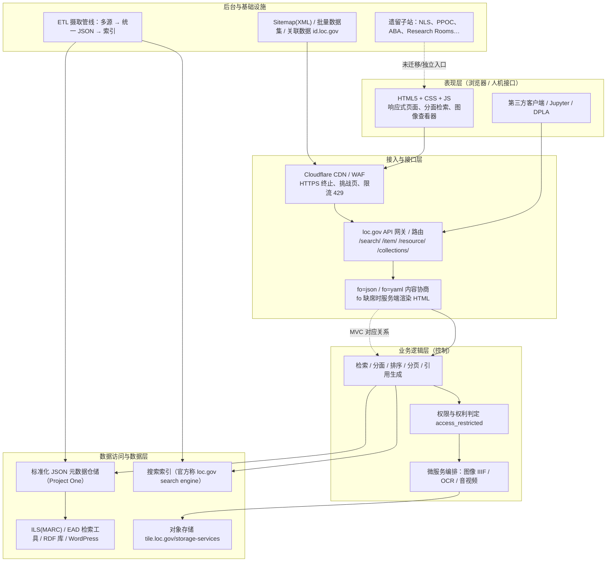
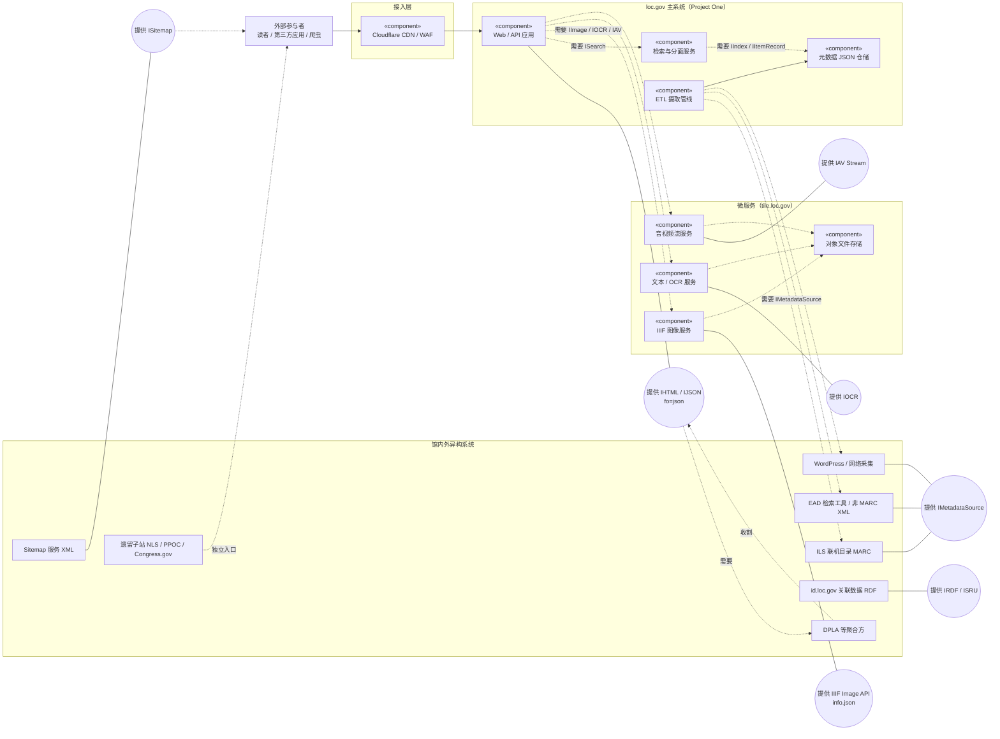

# 1113 实验：美国国会图书馆网站（loc.gov）的 UML 建模与架构分析

姓名：张力文　学号：2503408070　日期：2026-11-13
课程：《信息系统分析与设计》

**作业要求（图一）**：对照今天课程内容的**领域对象建模、系统应用架构设计、接口层设计**中的原则、要求及案例内容，分析美国国会图书馆网站的**状态图、交互图、类图、构件图**及其**软件架构体系和设计模式**。

**本文约定**

- 所有图均用 **Mermaid** 语法书写（与 1030 实验一致），在 VS Code 插件、Typora、GitHub 中可直接渲染；代码块下方另附符号/要素说明，不渲染也能读。
- 章节按原版课件（第 5 版）校订：第 8 章《领域对象建模》（类图、状态图）、**第 10 章《系统应用架构设计》**（分层 / MVC / SOA / 微服务）、第 11 章《接口层设计》（人机接口、构件图、软件接口技术）、第 12 章《面向对象设计》（顺序图等交互图、SOLID、GoF 23 种设计模式）、第 13 章《面向服务设计》。数字教材对应第 4 章「系统总体设计与智能体架构」及附录 H「建模基础速查」。
- **证据与推断分开写**：凡标注「可核验」的均有官方页面/响应头依据；标注「推断」的为由架构特征反推的设计判断，官网未公开源码或内部框架，不做无依据断言。

---

## 一、研究对象与系统边界：把 loc.gov 当作一个信息系统

### 1.1 系统目标与参与者

美国国会图书馆网站（<https://www.loc.gov/>）不是一张静态门户，而是一个**数字图书馆发布与检索系统**：把馆藏书目记录、数字化对象（图像 / 音视频 / 报纸 / 地图 / 网页存档）及其元数据，经加工后向公众提供检索、浏览、下载、引用与机器可读访问。

| 参与者 | 与系统的交互 |
| --- | --- |
| 普通读者 / 研究人员（浏览器） | 关键词检索、分面筛选、浏览集合、查看条目、下载图像、生成引用 |
| 第三方程序 / 数字人文研究者 / DPLA 等聚合方 | 调用 JSON API、IIIF、批量数据集、Sitemap 收割数据 |
| 搜索引擎爬虫 | 读取 `sitemap.xml`（XML 索引文件） |
| 馆内编目与数字化人员（后台） | 通过 ILS、EAD 检索工具、WordPress、网络采集等向 ETL 供数 |
| 外部独立子系统 | `catalog.loc.gov`（联机目录）、`id.loc.gov`（关联数据）、`api.congress.gov`、`chroniclingamerica.loc.gov`、`ask.loc.gov` |

### 1.2 主要功能与非功能需求（对照第 10 章「功能需求 / 非功能需求」）

| 类型 | 需求 | 网站体现（可核验） |
| --- | --- | --- |
| 功能 | 一站式检索 | `/search/?q=...` 覆盖藏品、法规、网页、博客、活动、新闻稿 |
| 功能 | 分面与排序 | `fa=location:ohio`、`dates=1924/1924`、`sb=date`，结果页左侧分面栏 |
| 功能 | 条目 / 资源 / 分页三层浏览 | `/item/{id}/`、`/resource/{id}/`、`segments`（报纸的一期 → 各版面） |
| 功能 | 机器可读输出 | 同一 URL 加 `?fo=json`（或 `fo=yaml`）即返回结构化数据 |
| 功能 | 图像与全文服务 | `tile.loc.gov/image-services/iiif/...`（IIIF）、`text-services/word-coordinates-service`（OCR 词坐标） |
| 非功能 · 性能 | 大结果集可用 | 默认每页 25 条，`c`≤1000、`sp` 翻页；深度分页上限 100 000 条 |
| 非功能 · 可用性 / 安全 | 抗滥用、防爬 | 全站 HTTPS；Cloudflare CDN/WAF（2026-11-13 直连返回 `403 / Cf-Mitigated: challenge / Server: cloudflare`）；限流 20~150 次/分钟，超限 `429` 或 CAPTCHA |
| 非功能 · 可维护性 / 可扩展 | 新藏品持续上线 | 官方博客称 API 是「数字内容及其元数据、ETL 流程与最终用户界面之间的结缔组织」；2012 年改版、2017 年公开 API |

### 1.3 关键事实依据（架构判断的地基）

1. **「一套后端、两种表述」**：官方说明「The loc.gov API was originally designed to power the loc.gov website, but in addition to providing HTML for the website it can provide ... JSON」；给任意 API 实现的页面 URL 追加 `?fo=json` 即可暴露该页底层数据。
2. **ETL + 搜索引擎**：LC Labs《Digital Scholarship at the Library of Congress》写明，展示与检索所用元数据由 **ETL** 从 ILS 的 MARC、METS、非 MARC XML、网络采集、WordPress 等多源摄取并索引，最终至少产出**每条记录统一的标准化 JSON**；数字图书馆平台代号 **Project One**，可通过界面或 API 访问，并作为 DPLA 的内容枢纽。
3. **微服务**：官方把 `tile.loc.gov` 上的三类能力明确称为 **microservices**——Text Services、Image Services（IIIF Image API 2.x）、Streaming Services（仿 IIIF 的 A/V API，HLS）。
4. **混合边界**：官方明确列出若干**未迁移到 API** 的子站（NLS、Publishers、ABA、Research Rooms、American Folklife Center、PPOC），说明是「新平台 + 遗留子系统」并存，而非纯单体或纯微服务。
5. **接口文档与限流**：`/apis/json-and-yaml/` 提供端点、参数、响应、速率限制全套文档；`id.loc.gov` 另有 Swagger 文档。

---

## 二、领域对象建模（第 8 章）：类图

### 2.1 用「名词短语策略」抽取概念类

按第 8 章「阅读用例规约 → 名词短语策略 / 不同对象分类识别 / 业务表格分析」的方法，从检索用例与条目页字段中抽取候选对象，再按「保持属性简单性」「不为关联定义属性」「不使用可导出属性」的原则精简：

| 名词短语（来自页面 / API 文档） | 概念类 | 关键属性（对应真实字段） |
| --- | --- | --- |
| 读者、访问者 | `Visitor` | sessionId、device |
| 检索式、查询 | `SearchQuery` | `q`、`fa`、`c`（默认 25）、`sp`、`sb`、`fo`、`at` |
| 检索结果、分面、分页 | `SearchResult` / `Facet` | `results[]`、`pagination`、`facets` |
| 数字集合（Bain Collection…） | `Collection` | slug（`civil-war-maps`）、title、itemCount |
| 条目（item） | `Item` | `id`、`title`、`date`、`contributor`、`subject`、`image_url`、`access_restricted`、`lccn` |
| 资源（resource） | `Resource` | `files[]`、`pdf`、`tif`、`url` |
| 分段 / 页（segment） | `Segment` | pageNumber、`image_url`、OCR 词坐标 |
| 数字文件 | `DigitalFile` | 格式（jpg / pdf / tif / mp4 / XML）、URI、大小 |
| 元数据记录 / 规范档 | `MetadataRecord` / `Authority` | MARCXML、MODS、Dublin Core、MADS/SKOS URI |
| 权利声明 | `RightsStatement` | rightsAdvisory、accessAdvisory |
| 引用 | `Citation` | Chicago / APA / MLA（`cite_this`） |
| 接口调用 | `APIRequest` | endpoint、fo、statusCode、rateLimit |

### 2.2 类图



**建模要点对照第 8 章原则**

- **关系类型**：`Collection o-- Item` 为**共享聚合**（一个条目可属于多个集合，如条目页同时列出 Bain Collection、PPOC、P&P Division、Online Catalog）；`Item *-- Resource *-- Segment` 为**组合**（整体销毁则部分无意义）；`Item <|-- WebArchiveItem` 为**泛化**（is a kind of，通过 `is a kind of` 验证）；`Item ..> Citation` 为**依赖 / 导出**（引用由书目数据自动生成，属「可导出属性不作为属性保存」）。
- **导航性**：`Item → Resource → Segment → DigitalFile` 单向导航，与 API 的 `at=item,resources` / `at=segments` 逐级展开一致；这正是第 8 章「关联导向性 = 源对象保存对目标对象的引用」。
- **属性简单性**：`Item` 只保留与检索/展示责任相关的字段；`contributor`、`subject` 等由关联到 `Authority` 的规范档解决，不把「教师姓名式」的外键字段塞进类里。
- **多重性**：检索结果 `0..*`（可为空）、资源 `1..*`、分面 `0..*`，对应真实 API 返回结构 `{ facets, pagination, results:[...] }`。

---

## 三、动态建模：状态图（第 8 章）与交互图（第 12 章）

### 3.1 状态图 A：`Item`（数字藏品条目）的一生

状态图用于「对单一的类绘制状态机，以表示对象的生命周期与状态转换」。这里选**条目**作为核心对象，因为它的状态变化最能反映 ETL → 索引 → 发布 → 权限管控的完整链路。



**UML 状态图要素对照（教材 8.5）**

| 要素 | 本图写法 |
| --- | --- |
| 初态 / 终态 | `[*] --> S1`、`S6 --> [*]`（实心圆 / 牛眼） |
| 简单状态 / 复合状态 | S1~S3、S5、S6 为简单状态；`S4` 内含子状态 S41→S42→S43，为**复合状态** |
| 转换标记 `事件 [监护条件] / 动作` | 如 `S4 --> S5 : 版权复核或权利变更 [access_restricted=true] / 降级为缩略图` |
| 内部行为 | `entry`：进入 S4 时写检索索引；`do`：S42 期间按 `sp` 分页拉取 resources；`exit`：退出 S4 时更新 `sitemap.xml`（推断，属 ETL/发布侧行为） |
| 与用例/流程模型互补 | 状态图解释「条目何时可被检索」，顺序图解释「一次检索如何穿过构件」，两者互相校验需求是否覆盖全生命周期 |

### 3.2 状态图 B：`SearchQuery`（一次检索请求）



### 3.3 交互图：顺序图（用例「检索并查看一件数字藏品」）

按第 12 章用例详细设计的 **BCE（boundary / control / entity）** 套路分配职责：界面为边界类、API 路由与检索服务为控制类、索引与元数据为实体类，微服务作为外部构件。



**基本流 / 备选流文字说明**

1. 基本流：输入关键词 → API 路由 → 索引检索 → 元数据补全 → HTML/JSON 表述 → 结果页 → 打开条目 → 图像/OCR/引用。
2. 备选流 A（分面迭代）：点击左侧分面即生成新 `fa` 查询，不修改原查询对象，符合「交互过程要清楚简单」。
3. 备选流 B（受限条目）：`access_restricted=true` 时只返回缩略图，UI 给出 Rights Advisory 说明。
4. 备选流 C（超量请求）：返回 `429` / CAPTCHA，客户端退避重试；深度分页超过 100 000 条时官方建议改用分面缩小结果集。
5. 备选流 D（遗留子系统）：命中未迁移子站时，官方说明需退回传统页面抓取，不属于 API 交互链。

> **通信图（协作图）补充**：若改用第 12 章的协作图，则去掉纵轴时间、保留对象间结构链接并给消息编号 1、1.1、2、2.1……；本用例中它更适合表现「`loc.gov API` 同时连着索引、元数据、三个微服务」的星形拓扑，而顺序图更适合表现「谁在等谁、有无循环调用」。两图信息等价，视角不同。

---

## 四、系统应用架构设计（第 10 章）：软件架构体系判断

### 4.1 结论先行

> **loc.gov 采用以 B/S 为基础、分层（三层/多层）为主体、MVC 与 API 优先（内容协商式前后端解耦）为特征、面向服务 / 微服务为扩展、CDN + 分布式部署支撑、并与若干未迁移遗留子系统并存的混合式应用架构。**
>
> 它不是纯 C/S，也不是「单体一把梭」；也不是典型 SPA 式前后端完全分离——**HTML 页面与 JSON 数据由同一套端点按 `fo` 参数产出**，属于「一套后端、两种表述」的 API-first 架构，但接口层已实现前后端解耦的效果。

### 4.2 分层映射图



### 4.3 判断依据（证据 → 架构结论）

| 课程概念（第 10 章） | 网站可核验证据 | 结论 |
| --- | --- | --- |
| B/S 与三层 | 全部交互经浏览器 HTTPS；表现层 / 业务逻辑层 / 数据访问层可清晰分离；`?fo=json` 直接暴露模型数据 | **B/S 三层，并扩展为多层**（控制层 / 接口层 / 索引层 / 存储层 / ETL 层） |
| 分层单向依赖 | 上层只经 `fo=json` 契约取数；更换索引或元数据来源不影响页面 | 符合「下层为上层提供服务、上层对下层一无所知」「修改某层不影响其他层」 |
| MVC | 同一 URL：`Model`=索引与 JSON 元数据，`View`=HTML 模板 / JSON 表述，`Controller`=端点路由与参数解析 | 具备 MVC 的「业务逻辑、数据、表示分离」，但不完全遵守分层单向约束（同第 10 章对 MVC 的说明） |
| 前后端分离 | 同一后端既能出 HTML 也能出 JSON；`/apis/` 文档鼓励第三方直接用 JSON 自建界面 | **接口级解耦**已实现；但页面主体仍服务端渲染，不是 Node.js 中间层式 SPA |
| 分布式 / 微服务 | 官方明确三类 microservices 部署在 `tile.loc.gov`；另有 `id.loc.gov`、`catalog.loc.gov`、`api.congress.gov` 等独立域名子系统 | 从单体走向**按业务能力拆分的分布式系统**，符合「每个服务单一职责、独立部署、通过轻量 API 通信」 |
| SOA / ESB | 未发现企业服务总线公开证据；集成靠 RESTful HTTP + 标准协议（IIIF、SRU、Sitemap、RDF） | 更接近**轻量级 SOA / 微服务**，而非重型 ESB 集中编排 |
| 软件框架 | 官方仅公开「图像服务由 Perl 改写为 Python 后扩展支持 IIIF」；未公开整站框架与搜索引擎产品 | 只记为局部实现事实；**不臆断** Django / Spring / Solr 用于 loc.gov 本体 |
| 非功能需求驱动架构 | 限流 20~150 次/分、深度分页 100 000 上限、`c`≤1000、CDN/WAF、多格式输出 | 性能、可用性、安全性在架构阶段即作为约束（附录 H.8） |

### 4.4 与教材案例的对照说明

- 教材「图书馆借书系统三层示例」= 表现层 / 业务逻辑层 / 数据访问层 + 数据库；loc.gov 把「数据库」换成了**搜索索引 + JSON 元数据仓储 + 对象存储 + 外部 ILS**，本质仍是同一分层思想，只是数据层异构且分布式。
- 教材「单体 → 分布式」：loc.gov 的主站 API 是统一入口（像单体），但图像、全文、音视频、关联数据、目录、立法数据各自独立成服务/子域，属于**渐进式拆分**（遗留子站尚未迁移，正是教材所说「单体与分布式长期共存」的现实版）。
- 教材「框架 = 架构模式的落地」：IIIF Image API、SRU/CQL、Sitemap 协议、MARC/MODS/DC 等**行业标准**在这里扮演了「框架/规范」的角色，保证不同语言、不同机构系统可互操作。

---

## 五、接口层设计（第 11 章）：人机接口、构件图与接口技术判断

### 5.1 人机接口（11.1）：采用传统 Web GUI / B/S 人机交互技术

第 11 章把信息系统接口分为「**软件系统与人的接口**」和「**软件系统与软件系统的接口**」。前者 loc.gov 采用的是**传统人机交互技术（键盘 / 鼠标 + 浏览器 GUI）**，不是触控、语音、动作或眼动追踪为主的系统；移动端为响应式 Web 适配。

| 第 11 章原则 / 八条黄金规则 | loc.gov 体现（可核验） |
| --- | --- |
| 交互过程清楚、简单，符合用户观点与习惯 | 全站统一顶部导航与搜索框；首页给出 Trending Top Searches（World War II、Civil War…）降低输入成本 |
| 适应不同操作水平的用户 | 既有「一个搜索框」的入门路径，也有 `fa` 分面、`sb` 排序、`at` 字段裁剪的进阶路径 |
| 输入最小化、错误信息有建设性 | 分面用可点击链接（`fa=subject:...`）代替手工输入；`429` 与深度分页给出明确退避/改用分面的建议；`404` 页面明确 |
| 数据验证越早越好、减少人工输入错误 | 「Cite This Item」自动生成 Chicago / APA / MLA 三种引用；条目元数据由后端统一给出，用户不必填写 |
| 界面一致性（图形用户界面设计原则 1~4） | 每个条目页固定「About this Item / Rights & Access / Obtaining Copies / Cite This Item」结构，词汇、颜色、次序前后一致 |
| 界面模型（Wireframe / Mockup / Prototype） | 检索结果页 = 可交互原型：左分面 + 中结果列表 + 排序/分页，等价于教材「注册顺序图」对应的界面原型 |
| 非功能：无障碍 | 音视频提供 `.vtt` 字幕，符合公共机构 Web 可访问性要求 |

### 5.2 构件图（11.2）

UML 构件图用**提供接口（ball，圆圈）**与**需要接口（socket，半圆）**表达构件之间的装配关系（教材 11.2 的「学籍管理系统」示例）。Mermaid 无原生构件图，下面用流程图等效表达：圆形节点 = 提供接口，虚线圆形节点 = 需要接口。



**构件清单与接口对照**

| 构件 | 提供接口 | 需要接口 | 说明 |
| --- | --- | --- | --- |
| Web / API 应用 | `IHTML`、`IJSON`（`/search/`、`/item/`、`/resource/`、`/collections/`） | `ISearch`、`IImage`、`IOCR`、`IAV` | 全站唯一编排入口（Facade） |
| 检索与分面服务 | `ISearch` | `IIndex`、`IItemRecord` | 处理 `q/fa/c/sp/sb/at` |
| 元数据 JSON 仓储 | `IItemRecord` | `IIndexUpdate` | ETL 输出的标准化 JSON |
| ETL 摄取管线 | `IIndexUpdate` | `IMetadataSource`（MARC / METS / EAD / XML / WordPress） | 适配器集群 |
| IIIF 图像服务 | `IIIF Image API`、`info.json` | `IFileStore` | `tile.loc.gov/image-services/iiif/{id}/{region}/{size}/{rotation}/{quality}.{format}` |
| 文本服务 | `IOCR`（词坐标 / 全文 / 片段高亮） | `IFileStore` | `?segment=&format=alto_xml&full_text=1` |
| 流媒体服务 | `IAV Stream`（含 HLS、`.vtt` 字幕） | `IFileStore` | 仿 IIIF 的 A/V URI |
| 关联数据 / SRU | `IRDF`、`ISRU/CQL` | — | 面向规范档与老式目录客户端 |
| Sitemap 服务 | `ISitemap`（XML） | — | 面向爬虫的间接接口 |
| CDN/WAF | `IHTTPS` | `IJSON` | 反向代理、缓存、限流、挑战页 |

> 标准 UML 记法（PlantUML，可贴到支持 PlantUML 的渲染器）示例：
> ```plantuml
> @startuml
> component "Web / API 应用" as WEB
> component "检索与分面服务" as SRCH
> interface "IJSON (fo=json)" as IJSON
> interface "ISearch" as IS
> WEB -() IJSON
> WEB -( IS
> SRCH -() IS
> @enduml
> ```
> 其中 `-()` 为提供接口（棒棒糖），`-(` 为需要接口（插座），与教材 11.2 的学籍系统示例一致。

### 5.3 接口技术判断：以「直接接口技术中的 RESTful API」为主

第 11 章 11.2.1 把常用软件接口技术分为两类：

- **直接**：RPC、RMI、Web Service（WSDL + SOAP）、RESTful API，以及 CORBA / Thrift、.NET WCF / ASP.NET Web API；
- **间接**：共享数据库、中间文件、消息中间件 / 消息队列。

**判断结论：**

| 层面 | 采用的接口技术 | 判定理由（可核验） |
| --- | --- | --- |
| **主接口（网站 ↔ 外界）** | ✅ **RESTful API（HTTP/HTTPS + JSON/YAML，直接接口）** | 用 URL 定位资源（`/search/`、`/item/{id}/`、`/resource/{id}/`、`/collections/{slug}/`）；`GET` + 查询字符串传参；无状态、无需 API key；返回 JSON/YAML；`fo` 做表述协商。完全符合教材「RESTful 方案限定 PUT/GET/DELETE/POST，每种操作可传递参数，有 REST API 设计规范」 |
| 图像 / A/V 专用接口 | ✅ **RESTful 风格的领域标准接口：IIIF Image API 2.x / A/V API** | `tile.loc.gov/image-services/iiif/{id}/full/pct:5/0/default.jpg`、`.../info.json`；参数全部编码在 URI 路径里，便于缓存；只需 HTTP GET |
| 全文 OCR 接口 | ✅ **HTTP 查询参数式 REST 接口** | `?segment=&format=alto_xml&full_text=1&byte_range=&q=` → JSON |
| 面向爬虫 / 批量获取 | ✅ **间接接口：中间文件（XML / 批量文件传送）** | `sitemap.xml` 索引 + 门户级 sitemap；`lccn.loc.gov/{id}/marcxml`、`/mods`、`/dc`；MARC 开放数据集、ZIP 批量下载 |
| 后台集成 | ✅ **间接接口：共享数据 / 批处理 ETL** | 多源元数据经 ETL 转成统一 JSON 再入索引；官方文档称 API 是「元数据 + ETL + 用户界面」的连接层；属文件/数据交换而非实时 RPC |
| 遗留与规范档接口 | ✅ **专用协议 / 关联数据接口** | SRU（XML + CQL）、Z39.50 网关；`id.loc.gov` 以可解析 URI + RDF/SKOS/MADS 提供内容协商（另有 Swagger 文档） |
| 未采用的 | ❌ SOAP/WSDL Web Service、RMI、CORBA、Thrift、WCF | 无 WSDL、无 SOAP Envelope、无 IDL/Stub、无 Java 语言绑定、无二进制协议；公开接口全部是语言无关的 HTTP + 文本表述 |
| 无法判定 | ⚠️ 消息队列 / 事件总线 | 官方未公开内部异步机制；ETL 与索引更新对外表现为批处理，故**不认定为消息中间件接口** |

**一句话回答「采用哪一种接口技术」**：loc.gov 的对外主接口是**直接接口技术中的 RESTful Web API**（HTTPS + 资源化 URL + JSON/YAML），并以 **IIIF、SRU/CQL、RDF 内容协商**等标准化 HTTP 接口为补充；对内及对外批量场景采用**间接接口技术**（XML Sitemap、MARCXML/MODS/DC 文件、批量数据集、ETL 共享数据/中间文件）。因此更准确的表述是：**「以 REST 为主、直接与间接接口技术并存的混合接口体系」，而不是某一种单一技术。**

### 5.4 按 11.2.2「软件接口设计四要素」描述主接口

以一次检索为例：

```http
GET https://www.loc.gov/search/?q=baseball&fa=location:ohio&c=50&sp=1&sb=date&fo=json&at=results,pagination,facets
```

| 四要素 | loc.gov 的具体设计 |
| --- | --- |
| **传输协议（如何通信）** | HTTPS/TCP，同步请求—响应；只读 GET；无认证（public，无 API key）；WAF/CDN 前置；速率 20 次/分钟（JSON API）、150（图像/文本/存储）、60（流媒体），超限 `429` + 封禁 1 小时 |
| **数据协议（数据如何编码）** | 主为 JSON，可切 YAML；另有 XML（sitemap、MARCXML、MODS、DC、ALTO/DjVu）、RDF（id.loc.gov）、JPEG/PNG/PDF/MP4（IIIF / 存储服务）；即教材所说「JSON、XML、私有协议」中的公开标准组合 |
| **接口定义格式（接口是什么功能）** | 端点 + 参数表：`fo`(json/yaml)、`q`(关键词)、`fa`(分面过滤，多值用 `|`)、`c`(每页条数，默认 25)、`sp`(页码)、`sb`(排序)、`at`(按点号取属性，如 `at=results.0`、`at=item,resources`)、`dates`(起止年)；无传统函数签名，靠 URL + 参数契约 |
| **数据内容（传递什么数据）** | `results[]`（`id`、`title`、`date`、`image_url`、`access_restricted`…）、`pagination`、`facets[]`（`title`、`count`、`on` URL）、`item`、`resources[]`、`segments[]`、`cite_this`；错误信息为 HTTP 状态码 429 / 404 / 403 + CAPTCHA 挑战页 |

### 5.5 对照 11.2.3「接口设计注意事项」

| 教材要求 | loc.gov 体现 |
| --- | --- |
| 1 规范化、有统一规范与管理制度 | `/apis/` 统一文档；遵循 IIIF、Sitemap、SRU/CQL、MARC/MODS/DC 等国际标准；`fo` / `fa` / `sp` 等参数全站一致 |
| 2 简单性、易于理解和使用 | 无 API key、无需 SDK；「在页面 URL 后加 `?fo=json`」即可取数；官方提供 Jupyter Notebook 示例 |
| 3 安全性（评估、访问控制、入侵检测、口令认证、防恶意代码、加密、日志） | 全站 HTTPS；Cloudflare WAF/挑战页；按接口分级限流；只读公开数据不开放写操作；`429` 与封禁策略明确（内部认证/日志细节未公开，属推断） |
| 4 提供批量文件传送方式 | XML Sitemap 树、MARC 开放数据集、条目级 MARCXML/MODS/DC、ZIP 数据包、`c=1000` 批量分页 |
| 5 每个环节保留详细日志便于错误分析 | 官方建议客户端处理 `429` 与 CAPTCHA 并退避重试；深度分页与速率限制说明反映服务端具备监控与限流日志（推断） |
| 6 编写规范的接口文档、统一模板 | `loc.gov/apis` 下有 Introduction / Requests / Endpoints / Parameters / Responses / Working Within Limits 分册；`id.loc.gov` 另有 Swagger API 文档 |

---

## 六、软件架构体系与设计模式（第 10 / 12 / 13 章）

教材明确区分：**分层、MVC、微服务等是「架构模式」，面向全局；GoF 23 种是「设计模式」，面向局部**。下面分开列。

### 6.1 架构模式（全局）

| 架构模式 | 在 loc.gov 的落点 | 依据 / 推断 |
| --- | --- | --- |
| B/S + 三层/多层分层 | 浏览器 → CDN/接口层 → 业务层 → 索引/存储/ETL 层 | 可核验（本文 4.2） |
| MVC | Model=索引/JSON，View=HTML/JSON 表述，Controller=端点路由 | 可核验 + 推断 |
| 微服务 / 轻量 SOA | 图像、OCR、音视频、关联数据、目录、立法数据各自成服务/子域 | 可核验（官方称 microservices） |
| API Gateway / Facade | 统一 `/apis/` 与 `fo=json` 屏蔽后端异构 | 推断（由「API 是结缔组织」反推） |
| CDN / 反向代理 | Cloudflare 缓存、WAF、限流 | 可核验（响应头） |
| 混合架构（遗留共存） | 未迁移子站仍以传统页面提供 | 可核验（官方端点文档列举） |

### 6.2 GoF 设计模式（局部，含推断标注）

| 模式 | 类型 | 在系统中的对应 | 解决什么问题 |
| --- | --- | --- | --- |
| **Adapter 适配器** | 结构型 | ETL 把 MARC、METS、EAD、非 MARC XML、网络采集、WordPress 统一转换成标准 JSON；SRU/Z39.50 网关适配老目录（可核验） | 异构元数据来源接口不一致 |
| **Facade 门面** | 结构型 | 一个 `?fo=json` 入口屏蔽索引、仓储、三个微服务与遗留库（推断） | 降低客户端与子系统耦合 |
| **Proxy 代理** | 结构型 | Cloudflare CDN/WAF 代理回源；`tile.loc.gov` 代理对象存储并按需生成派生图（可核验 + 推断） | 缓存、访问控制、按需变换 |
| **Composite 组合** | 结构型 | `Item → Resource → Segment → DigitalFile` 树（API 中 `resources[]` / `segments[]`）（可核验） | 统一处理单件与多页/多部件对象 |
| **Strategy 策略** | 行为型 | `fo=json/yaml/HTML`、`sb` 多种排序、`lccn.loc.gov/.../marcxml|mods|dc` 多种元数据格式、IIIF 的 quality/format 组合（可核验） | 同一请求可替换表述与算法 |
| **Iterator 迭代器** | 行为型 | `c`/`sp` 分页、`pagination` 对象、深度分页 100 000 上限（可核验） | 大结果集遍历而不暴露索引结构 |
| **Template Method 模板方法** | 行为型 | ETL 固定骨架：抽取 → 转换 → 标准化 JSON → 索引 → 发布，各来源只实现差异步骤（推断） | 复用流程、规范新藏品接入 |
| **Observer / Publish-Subscribe** | 行为型 | Sitemap 更新、DPLA 收割、第三方应用消费公开 API（推断，官方未说明内部消息机制） | 数据变更通知外部聚合方 |
| **Factory Method 工厂方法** | 创建型 | 按 `fo` / `format` / 资源类型生成不同表述与文件（推断） | 屏蔽具体产品类 |

### 6.3 SOLID 原则对照（第 12 章 12.4）

- **SRP 单一职责**：每个微服务只做一件事（图像、OCR、流媒体），检索与元数据分离。
- **OCP 开闭**：新增藏品格式或新服务（如 2025 年 Chronicling America 并入 loc.gov API）通过新增端点/微服务扩展，不改既有 HTML 页面契约。
- **DIP 依赖倒置**：前端与第三方程序依赖「`fo=json` 抽象契约」，不依赖具体 ILS、数据库或搜索引擎产品；后端实现可替换。
- **ISP 接口隔离**：`at=` 允许只取 `results` / `pagination` / `facets` / `item` / `resources`，客户端不被迫接收全量字段。
- **高内聚低耦合（第 9 章 / 附录 H.5）**：构件内部职责集中，构件之间只经明确 HTTP 接口通信；这正是教材「总体设计四原则」在超大型公共数字图书馆上的体现。

---

## 七、小结

1. **四张图各自回答一个问题**：类图回答「系统里有哪些领域对象、它们如何关联」（`Collection–Item–Resource–Segment–DigitalFile` 的组合链是 loc.gov 数据模型的骨架）；状态图回答「一个条目/一次检索会经历哪些状态、由什么事件驱动」（ETL → 索引 → 在线发布 → 受限/撤回）；交互图（顺序图）回答「一次检索请求如何穿过 CDN、API 路由、检索服务、索引与三个微服务」；构件图回答「系统由哪些可替换构件、通过哪些提供/需要接口装配」。
2. **应用架构**：B/S 多层分层 + MVC/API 优先 + 面向服务/微服务 + CDN 分布式部署 + 遗留子系统共存的混合体系；分层单向依赖与高内聚低耦合是其能持续接入新藏品、支撑千万级对象的关键。
3. **接口技术**：对外主接口为**直接接口技术中的 RESTful API**（HTTPS + 资源化 URL + JSON/YAML，无 WSDL/IDL/Stub），辅以 IIIF、SRU/CQL、RDF 等标准 HTTP 接口；批量与后台场景采用**间接接口**（XML Sitemap、MARCXML/MODS/DC、批量数据集、ETL 中间文件/共享数据）。人机接口则是传统 Web GUI，遵循一致、简单、输入最小化与错误预防原则。
4. **设计模式**：架构层面用分层、MVC、微服务、门面/代理；局部用适配器（多源元数据归一）、组合（条目树）、策略（多表述）、迭代器（分页）、模板方法（ETL）等 GoF 模式，整体符合 SOLID。
5. **局限与边界**：官方未公开 loc.gov 主站的编程语言、框架、搜索引擎产品与内部消息机制；本文所有涉及内部实现的「设计模式/架构」判断均标注为推断，可由公开 URL、API 文档与响应头验证的部分均给出来源。另需注意：`/nls/`、`/pictures/` 等未迁移子站不服从上述 API 架构，分析时不应把它们纳入同一构件图边界。

---

## 八、参考资料（访问日期：2026-11-13）

**课程材料**

1. 《信息系统分析与设计》（第 5 版）原版课件：第 8 章《领域对象建模》、第 9 章《系统设计概述》、第 10 章《系统应用架构设计》、第 11 章《接口层设计》、第 12 章《面向对象设计》、第 13 章《面向服务设计》（见数字教材 `html教材/ch04.html` 的「原版课件对照」）。
2. 数字教材《信息系统分析与设计（智能体实战版）》第 4 章、附录 H「建模基础速查」：<https://dsdh-python.github.io/ISAD/>。

**美国国会图书馆官方资料**

3. 首页 <https://www.loc.gov/> ；条目页示例 <https://www.loc.gov/item/2014717546/>。
4. APIs 总览 <https://www.loc.gov/apis/> ；JSON/YAML API <https://www.loc.gov/apis/json-and-yaml/>。
5. 请求 / 端点 / 参数 / 限制：<https://www.loc.gov/apis/json-and-yaml/requests/>、<https://www.loc.gov/apis/json-and-yaml/requests/endpoints/>、<https://www.loc.gov/apis/json-and-yaml/requests/parameters/>、<https://www.loc.gov/apis/json-and-yaml/working-within-limits/>。
6. Sitemaps <https://www.loc.gov/apis/sitemaps/> ；Image Services（IIIF）<https://www.loc.gov/apis/micro-services/image-services/> ；Text Services <https://www.loc.gov/apis/micro-services/text-services/> ；Streaming Services <https://www.loc.gov/apis/micro-services/streaming-services/>。
7. Additional APIs <https://www.loc.gov/apis/additional-apis/> ；Linked Data Service <https://www.loc.gov/apis/additional-apis/linked-data-service/> ；SRU / Z39.50 <https://www.loc.gov/apis/additional-apis/search-retrieval-via-url/>。
8. LC Labs《Digital Scholarship at the Library of Congress》（ETL、Project One、多源元数据）：<https://labs.loc.gov/static/labs/work/reports/DHWorkingGroupPaper-v1.0.pdf>。
9. LC Labs 数据 API 清单：<https://data.labs.loc.gov/apis/> ；数字学术指南：<https://guides.loc.gov/digital-scholarship/accessing-digital-materials>。
10. The Signal 博客：API 文档访谈（2012 改版 / 2017 公开 API / API 是 ETL 与 UI 的结缔组织）<https://blogs.loc.gov/thesignal/2023/06/discussing-library-of-congress-api-documentation-with-laura-wrubel-and-patrick-rourke/>；IIIF 实现（Perl → Python）<https://blogs.loc.gov/thesignal/2018/05/iiif-at-the-library-of-congress>。
11. Dublin Core 2017 会议论文（Project One 作为 DPLA 内容枢纽）：<https://dcevents.dublincore.org/IntConf/dc-2017/paper/download/504/576>。
12. 本站 HTTPS 响应头实测：`Server: cloudflare`、`Cf-Mitigated: challenge`（2026-11-13）。
