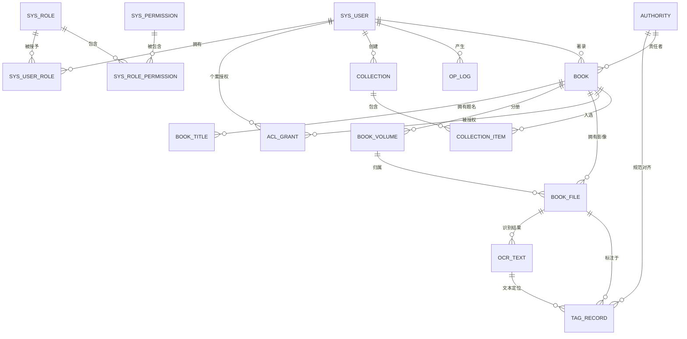

# 地方古籍文献数字化平台——面向服务（SOA）设计与数据层设计

> 设计范围：问题 1（面向服务设计）+ 问题 2（数据层概念与逻辑模型设计）
> 设计输入：题目背景中的 4 类角色/外部系统、6 项业务能力、5 条业务约束

---

## 0. 设计输入梳理与总体思路

### 0.1 业务能力 → 服务域（能力地图）

| 业务能力 | 覆盖角色 | 归入服务域 |
|---|---|---|
| 扫描影像上传、大图存储 | 档案管理员 | 文件存储（基础能力） |
| 元数据著录、卷册叶组织 | 档案管理员 | 古籍著录（业务） |
| OCR 识别 | 系统内部、其他资源类型 | OCR 识别（基础能力，可复用） |
| OCR 文本校对 | 研究人员 | OCR 校对（业务） |
| 人物/地名实体标签 + 审核 | 系统 + 档案管理员 | 实体标签（基础能力）/ 标签审核（业务） |
| 检索（访客简单检索 / 研究人员深度检索） | 全部角色 + 上层系统 | 检索（基础能力）+ 统一检索编排（编排） |
| 焦点标注、专题数据集还原 | 研究人员 | 专题数据集（业务）+ 导出编排（编排） |
| 成果外部共享、门户对接 | 图书馆门户、学术成果系统 | 开放共享（业务）+ 共享编排（编排） |
| 密级管控、访问留痕 | 全部 | 权限鉴权 / 审计日志（基础能力） |

### 0.2 五条业务约束 → 设计落点（可追溯）

| # | 业务约束 | 设计落点 |
|---|---|---|
| 1 | 大图、OCR 文本、格式元数据分开存储 | 大图入对象存储，`book_file` 只存对象键；文本入 `ocr_text`；元数据入 `book`。三者由不同服务独占，接口而非文件路径耦合（见 1.3、2.3） |
| 2 | 公开 / 校内 / 涉密三级权限隔离 | 服务层：`auth-service` 统一做 PDP 决策 + `max_security_level`；数据层：`security_level` 独立列 + 资源级 `acl_grant`（不放在 JSON 里，保证可索引） |
| 3 | OCR、实体标签具备独立能力可复用 | 单独成服务，契约只依赖「影像引用 → 结构化结果」，不依赖古籍业务模型；引擎以适配器实现（见 1.2 契约 B、1.3 第 3 条） |
| 4 | 操作留痕：谁、何时、改了哪条记录 | `audit-service` 统一收集 `trace_id`，`op_log` 表 append-only + 前后快照；高风险动作同步强一致写，普通动作异步写 |
| 5 | 允许紧密耦合：可换 OCR 引擎、可换数据库 | 引擎侧 Adapter + SPI + 灰度双跑；数据侧「一服务一 Schema、仓储层隔离、禁止跨服务 JOIN」，SQL 只出现在仓储实现里 |
| — | 支持后续新增方志、族谱等资源类型 | `book.resource_type` + 类型扩展表 + 元数据模板校验；新增类型只加订阅者，不改动已有服务 |

---

# 问题 1：面向服务设计

## 1.1 服务边界划分与核心服务清单

### 1.1.1 划分原则

1. **按业务能力切，不按页面切**：一个服务对应一个可独立演进的业务能力，而非一个 UI 模块。
2. **按变更频率切**：OCR 引擎、检索实现属于高频替换点，单独封装；著录规则属于低频变化，独立成服务避免被拖累。
3. **按复用范围切**：凡被 2 个以上业务域使用的逻辑（文件、OCR、标签、检索、鉴权、留痕）上提为基础能力服务。
4. **按数据所有权切**：每个服务独占自己的表，其他服务只能通过接口取数——这是"可更换数据库"的前提。
5. **编排与业务分离**：跨 3 个以上服务的长流程放入编排服务，业务服务保持无状态、幂等、可单点重试。

### 1.1.2 核心服务清单

#### A. 基础能力服务（L0，跨业务复用，不含业务流程）

| 编号 | 服务名称 | 核心职责（一句话） | 复用方 | 独占数据 | 调用方式 |
|---|---|---|---|---|---|
| S01 | 文件存储服务 file-service | 分片上传、SHA256 秒传、缩略图/水印派生、短时签名 URL、存储后端适配（MinIO/OSS/S3） | 古籍、方志、族谱、成果附件 | `book_file`、对象存储桶 | 同步（签名/元数据）+ 直传对象存储 |
| S02 | OCR 识别服务 ocr-service | 影像 → 版面结构化文本（行/字坐标 + 置信度），引擎可插拔与灰度 | 古籍、方志、民国报刊、档案 | `ocr_text` | 异步 Job + 事件回调 |
| S03 | 实体标签服务 ner-service | 人物/地名/年号/职官/书名识别与规范档对齐，支持单篇与批量 | 古籍、族谱人物、方志地名 | `tag_record`（机器产出部分） | 异步批量为主，单篇可同步 |
| S04 | 检索服务 search-service | 元数据 + 全文统一检索、分面聚合、高亮，封装 ES | 全部前端、上层系统 | ES 索引（派生数据） | 同步 |
| S05 | 权限鉴权服务 auth-service | SSO 对接、令牌签发、PDP 决策（用户×资源×密级×动作）、资源级授权 | 全部服务 | `sys_user`/`sys_role`/`sys_permission`/`acl_grant` | 同步 |
| S06 | 规范档服务 authority-service | 人物/地名/年号规范档维护、别名映射与消歧（供 S03 对齐） | S02/S03/B04 | `authority`（`auth_type` 区分人物/地名/年号/职官/机构） | 同步 |
| S07 | 字典服务 dict-service | 朝代、四部分类、版本类型、密级等码表与元数据模板 | 全部 | `dict_item`/`dict_schema` | 同步（本地缓存） |
| S08 | 审计日志服务 audit-service | 统一留痕、按 `trace_id` 汇聚、防篡改存储与检索 | 全部服务 | `op_log` | 异步事件 + 高风险同步 |
| S09 | 通知服务 notify-service | 站内信/邮件/企业微信模板通知 | 审核、导出、共享 | `notify_msg` | 异步 |

#### B. 业务服务（L1，面向具体用例，含业务规则）

| 编号 | 服务名称 | 核心职责 | 主要角色 | 独占数据 | 调用方式 |
|---|---|---|---|---|---|
| B01 | 古籍著录服务 catalog-service | 元数据著录与校验、卷/册/叶组织、状态机（草稿→待审→发布→下架）、版本冲突检测 | 档案管理员 | `book`、`book_title`、`book_ext_*` | 同步 |
| B02 | OCR 校对服务 proofread-service | 校对任务分派、原文/识别结果逐字比对、校对留痕与版本回滚 | 研究人员 | `proof_task`、`ocr_text.text_corrected` | 同步（保存）+ 异步（批量比对） |
| B03 | 标签审核服务 review-service | 机器标签的通过/驳回/改挂规范档、批量审核、置信度阈值策略 | 档案管理员 | `tag_review_task`（审核任务与意见） | 同步 |
| B04 | 专题数据集服务 dataset-service | 专题创建、条目编排、批注、数据集定义（供导出） | 研究人员 | `collection`、`collection_item` | 同步 |
| B05 | 开放共享服务 openapi-service | 外部应用注册、API Key/配额、成果引用登记、共享协议 | 图书馆门户、成果系统 | `sys_open_app`、`share_record` | 同步（网关鉴权） |
| B06 | 访问授权服务 access-grant-service | 涉密/未开放文献的下载与阅览申请、审批链、临时授权 | 全部角色 | `acl_grant`（申请类） | 同步 |
| B07 | 统计分析服务 analytics-service | 实体时空分布、词频、人物共现、馆藏统计（专题分析） | 研究人员、管理层 | 分析宽表/物化视图 | 异步预计算 + 同步读取 |

#### C. 编排服务（L2，只编排不承载业务规则）

| 编号 | 服务名称 | 编排的流程 | 调用方式 | 失败处理 |
|---|---|---|---|---|
| O01 | 古籍入库编排 ingest-orchestrator | 上传校验→去重→归档→OCR→NER→建索引→置待审 | 异步（状态机 + Saga） | 步骤级补偿（删临时对象、撤销索引），进入死信待人工 |
| O02 | 审核发布编排 publish-orchestrator | 审核通过→密级生效→索引刷新→事件推送门户/成果系统 | 异步（事件驱动） | 最终一致 + 定时对账 |
| O03 | 统一检索编排 search-orchestrator | 并行查 ES → 批量权限裁剪 → 密级过滤 → 高亮合并 → 结果组装 | 同步 | 权限服务超时则降级为"仅公开级"（安全兜底） |
| O04 | 专题导出编排 export-orchestrator | 抽元数据+校对文本+影像清单→加水印→打包→通知下载 | 异步 Job | 重试 3 次→死信→通知失败 |
| O05 | 对外共享编排 share-orchestrator | 外部调用→应用鉴权→聚合本平台数据→计量→留痕 | 同步（查询）+ 异步（推送） | 熔断 + 配额限制 |

> 职责不重叠说明：S02 只"识别"，不判断该不该识别；B02 只"校对"，不重新识别；B03 只"审核标签"，不生成标签（`tag_record` 的唯一写入方是 S03，B03 的审核结论通过接口回写，避免双写同一张表）；O01 只"串联"，不含密级规则（密级规则在 S05）。检索的"过滤"在 O03，"查询"在 S04，前者管权限、后者管相关性，边界清晰。

### 1.1.3 角色 × 服务矩阵（验证边界与权限隔离）

| 服务 | 档案管理员 | 研究人员 | 访客 | 上层系统 |
|---|---|---|---|---|
| S01 文件存储 | 上传/派生 | 只读（签 URL） | 仅缩略图 | 按协议取图 |
| S02 OCR | 触发重跑 | 触发单叶重识别 | — | — |
| B01 著录 | 全量 | 只读 | 只读公开级 | 只读公开级 |
| B02 校对 | 分配任务 | 校对 | — | — |
| B03 标签审核 | 审核 | 提交人工标注 | — | — |
| B04 专题 | 只读 | 增删改（本人） | — | — |
| B06 访问授权 | 审批 | 申请 | 申请（涉密需单位证明） | — |
| B05 开放共享 | 配置 | 引用登记 | — | 调用 + 计量 |

### 1.1.4 同步/异步总览

- **同步**：S01 签名、S04 检索、S05 鉴权、S06 规范档、S07 字典、B01 著录、B02 保存、B03 审核、B04 专题、B05 网关、B06 申请、O03 检索编排、O05 查询。
- **异步（MQ/Job）**：S02 OCR、S03 批量标签、S08 日志、S09 通知、B07 统计、O01 入库、O02 发布、O04 导出、O05 推送。

---

## 1.2 接口契约（选 3 个服务：检索、OCR、入库编排）

### 1.2.0 全局通用约定

| 项 | 约定 |
|---|---|
| 协议/风格 | HTTPS + REST + JSON（`Content-Type: application/json; charset=utf-8`） |
| 版本 | URL 版本 `/api/v1/...`；事件 schema 带 `version`；**只增字段、不改语义、不删字段** |
| 认证 | 用户侧 `Authorization: Bearer <JWT>`；服务间 mTLS + 服务令牌（scope 授权） |
| 身份可信 | 权限一律以令牌解析结果为准，**禁止**由调用方在 body 里"声明自己是管理员" |
| 幂等 | 写接口必带 `Idempotency-Key`，服务端按 (key, 路由) 去重 24h |
| 追踪 | 请求头 `X-Trace-Id`（缺省由网关生成），全链路透传并写入 `op_log.trace_id` |
| 分页 | 偏移分页 `page.from/page.size`（`size ≤ 100`）；导出类用 cursor |
| 时间/编码 | RFC3339（`2026-11-20T17:23:06+08:00`）；UTF-8；古籍原文保留繁体，另存规范化字段 |
| 错误体 | `{code, message, traceId, timestamp, details[]}`，与 HTTP 状态码并用 |

**统一错误码表**

| code | HTTP | 含义 | 调用方处理建议 |
|---|---|---|---|
| 40001 | 400 | 参数校验失败 | 按 `details[].field` 提示，不重试 |
| 40101 | 401 | 未认证 / 令牌过期 | 重新登录或刷新令牌 |
| 40301 | 403 | 权限不足（角色/动作不允许） | 提示无权限，不重试 |
| 40302 | 403 | 密级不足或资源未开放 | 引导走 B06 申请 |
| 40401 | 404 | 资源不存在（或对当前用户不可见） | 提示已下架/不存在 |
| 40901 | 409 | 版本冲突（乐观锁） | 拉取最新版本后合并重提 |
| 40902 | 409 | 重复请求（幂等键命中） | 直接复用首次结果 |
| 42201 | 422 | 状态机不允许（如未审核通过就发布） | 提示前置条件 |
| 42202 | 422 | 影像质量不足（可重扫/可换引擎） | 提示人工介入 |
| 42901 | 429 | 限流 | 按 `Retry-After` 退避 |
| 50021 | 500 | OCR 引擎执行失败 | 判断 `retryable` 后重试 |
| 50301 | 503 | 依赖服务/存储不可用 | 退避重试，任务置 RETRYING |
| 50001 | 500 | 未预期内部错误 | 携 `traceId` 报障 |

### 1.2.1 契约 A — 检索服务（S04，同步）

- **服务名称**：检索服务 `search-service`
- **服务职责**：对已发布古籍做元数据 + OCR 全文 + 实体标签的统一检索，返回结果、分面与高亮；不做权限决策（由 O03 传入已裁剪的可见范围），不写任何业务数据。
- **接口**：`POST /api/v1/search/books`

**入参**

```json
{
  "keyword": "康熙 徽州府志",
  "scope": "ALL",
  "filters": {
    "dynastyCodes": ["QING"],
    "categoryCodes": ["SHI"],
    "resourceTypes": ["GUJI", "FANGZHI"],
    "pubYearFrom": 1644,
    "pubYearTo": 1911,
    "entityTags": [{ "entityType": "PLACE", "authId": 10231 }],
    "holdingOrg": "AHU-LIB",
    "securityLevels": [1, 2]
  },
  "sort": [{ "field": "relevance", "order": "desc" }],
  "page": { "from": 0, "size": 20 },
  "highlight": true,
  "facets": ["dynastyCode", "categoryCode", "securityLevel", "holdingOrg"]
}
```

字段说明：`keyword` 必填、长度 ≤ 200；`scope` 取值 `ALL | TITLE | FULLTEXT | TAG`；`securityLevels` 由编排层按令牌权限**注入而非透传**，若调用方传入超权值将被强制收窄。

**出参（200）**

```json
{
  "code": 0,
  "traceId": "9f1c2a7e5b8d4c60",
  "timestamp": "2026-11-20T17:23:06+08:00",
  "data": {
    "total": 137,
    "items": [
      {
        "bookId": 100231,
        "bookCode": "GG-2026-000123",
        "title": "徽州府志",
        "author": "（清）丁廷楗 修",
        "dynastyCode": "QING",
        "pubYearText": "清康熙三十八年（1699）刻本",
        "securityLevel": 1,
        "resourceType": "FANGZHI",
        "coverThumbUrl": "https://oss.internal/guji-thumb/2026/11/100231/c1.jpg?X-Sig=...&X-Exp=1790000000",
        "highlight": { "title": "<em>徽州府志</em>" },
        "matchedFileId": 88231,
        "matchedPageNo": 7,
        "matchedSnippet": "……<em>徽州府</em>領縣六，曰歙、曰休寧……"
      }
    ],
    "facets": {
      "dynastyCode": [{ "code": "QING", "count": 137 }],
      "securityLevel": [{ "code": "1", "count": 120 }, { "code": "2", "count": 17 }]
    },
    "page": { "from": 0, "size": 20, "hasMore": true }
  }
}
```

**异常返回**

```json
{
  "code": 40001,
  "message": "参数校验失败",
  "traceId": "9f1c2a7e5b8d4c60",
  "timestamp": "2026-11-20T17:23:06+08:00",
  "details": [{ "field": "page.size", "reason": "must be <= 100" }]
}
```

```json
{
  "code": 50301,
  "message": "检索集群暂不可用，已降级为元数据前缀检索",
  "traceId": "9f1c2a7e5b8d4c60",
  "timestamp": "2026-11-20T17:23:06+08:00",
  "details": [{ "field": "engine", "reason": "es_timeout", "retryable": true, "degradedMode": "MYSQL_PREFIX" }]
}
```

**行为约定**：命中涉密（`security_level=3`）但无权限时，**不返回条目详情**，仅在 `total` 中排除；相关度打分不以权限变化（避免通过结果差异推断涉密文献存在）。响应 30s 内可缓存，缓存键含权限指纹。

### 1.2.2 契约 B — OCR 识别服务（S02，异步，可复用）

- **服务名称**：OCR 识别服务 `ocr-service`
- **服务职责**：接收"某个影像文件对象"的引用，异步完成版面分析与文字识别，产出结构化文本与坐标；**不感知古籍业务**（不知道什么是"卷册叶"，只认 `bizType/bizId`），因此方志、族谱、民国报刊、档案均可复用。
- **接口**：`POST /api/v1/ocr/jobs`、`GET /api/v1/ocr/jobs/{jobId}`

**入参**

```json
{
  "bizType": "GUJI",
  "bizId": "book:100231",
  "fileRef": {
    "fileId": 88231,
    "storageType": "S3",
    "bucket": "guji-raw",
    "objectKey": "2026/11/GG-2026-000123/v01/p0007.tif",
    "sha256": "c1f0e9b2a7d34f5e8c6b1a09d2e3f4a5b6c7d8e9f0a1b2c3d4e5f60718293a4b"
  },
  "engine": { "code": "AUTO", "options": { "lang": "lzh", "variant": "trad", "layout": true, "vertical": true } },
  "callback": { "url": "https://ingest.internal/cb/ocr", "event": "ocr.completed" },
  "priority": 5,
  "idempotencyKey": "ocr:88231:v1"
}
```

`engine.code` 支持 `AUTO | PADDLE | ALIYUN | CUSTOM:<vendor>`；`AUTO` 由路由策略按语言/版式/质量选引擎，调用方无需关心供应商——这是"未来可替换 OCR 引擎"的接口保证。

**出参（202 Accepted）**

```json
{
  "code": 0,
  "traceId": "3a7b1c9d",
  "data": {
    "jobId": "ocr-20261120-000137",
    "status": "QUEUED",
    "queuePosition": 12,
    "estimatedSeconds": 40,
    "pollUrl": "/api/v1/ocr/jobs/ocr-20261120-000137"
  }
}
```

**查询结果（200，`status=SUCCEEDED`）**

```json
{
  "code": 0,
  "data": {
    "jobId": "ocr-20261120-000137",
    "status": "SUCCEEDED",
    "engineUsed": "ALIYUN",
    "engineVersion": "2026.09",
    "result": {
      "ocrId": 550012,
      "charCount": 812,
      "avgConfidence": 0.9132,
      "textUrl": "https://oss.internal/ocr-json/550012.txt?X-Sig=...&X-Exp=1790000000",
      "layoutUrl": "https://oss.internal/ocr-json/550012.layout.json?X-Sig=...&X-Exp=1790000000"
    },
    "metrics": { "elapsedMs": 38210, "retryCount": 0 }
  }
}
```

> 大文本走签名 URL 而不塞进 JSON 响应体，避免响应膨胀与日志泄密；文本本体由调用方按 `ocrId` 落库（`ocr_text`）。

**异常返回**

```json
{
  "code": 42202,
  "message": "影像质量不足，识别置信度低于阈值",
  "traceId": "3a7b1c9d",
  "details": [{ "field": "fileRef.fileId", "reason": "blur_ratio=0.42,dpi=210", "suggestion": "建议 300dpi 以上灰度重扫" }]
}
```

```json
{
  "code": 50021,
  "message": "OCR 引擎执行失败",
  "traceId": "3a7b1c9d",
  "details": [{ "field": "engine", "reason": "engine_timeout", "retryable": true, "failoverEngine": "PADDLE" }]
}
```

**异步事件（回调 / 订阅）**

```json
{
  "specversion": "1.0",
  "id": "evt-7f3a91",
  "type": "ocr.completed",
  "version": "v1",
  "source": "ocr-service",
  "subject": "file:88231",
  "time": "2026-11-20T17:24:05+08:00",
  "traceId": "3a7b1c9d",
  "data": { "jobId": "ocr-20261120-000137", "bizType": "GUJI", "bizId": "book:100231", "fileId": 88231, "ocrId": 550012, "avgConfidence": 0.9132 }
}
```

### 1.2.3 契约 C — 古籍入库编排服务（O01，异步编排）

- **服务名称**：古籍入库编排服务 `ingest-orchestrator`
- **服务职责**：把"上传-归档-识别-标注-索引"这条跨 5 个服务的长流程编排为一个可查询、可重试、可补偿的作业；只做流程控制与状态流转，业务规则仍落在各业务服务。
- **接口**：`POST /api/v1/ingest/jobs`、`GET /api/v1/ingest/jobs/{jobId}`、`POST /api/v1/ingest/jobs/{jobId}:retry`

**入参**

```json
{
  "bookId": 100231,
  "files": [
    { "fileId": 88231, "volumeNo": 1, "pageNo": 7, "role": "RAW" },
    { "fileId": 88232, "volumeNo": 1, "pageNo": 8, "role": "RAW" }
  ],
  "options": {
    "dedupPolicy": "BY_SHA256",
    "runOcr": true,
    "runNer": true,
    "autoPublish": false,
    "notifyUserId": 10086
  }
}
```

**出参（202）**

```json
{
  "code": 0,
  "data": {
    "jobId": "ing-20261120-000052",
    "status": "RUNNING",
    "steps": [
      { "name": "UPLOAD_VERIFY", "status": "SUCCEEDED", "costMs": 320 },
      { "name": "ARCHIVE", "status": "RUNNING" },
      { "name": "OCR", "status": "PENDING" },
      { "name": "NER", "status": "PENDING" },
      { "name": "INDEX", "status": "PENDING" },
      { "name": "TO_REVIEW", "status": "PENDING" }
    ],
    "pollUrl": "/api/v1/ingest/jobs/ing-20261120-000052"
  }
}
```

**异常返回**

```json
{
  "code": 40902,
  "message": "重复提交，已返回首次创建的任务",
  "traceId": "b2c3d4e5",
  "details": [{ "field": "Idempotency-Key", "reason": "duplicate", "existingJobId": "ing-20261120-000052" }]
}
```

```json
{
  "code": 50301,
  "message": "对象存储不可用，任务已挂起并进入重试队列",
  "traceId": "b2c3d4e5",
  "details": [{ "field": "step", "reason": "ARCHIVE/storage_unavailable", "retryable": true, "nextRetryAt": "2026-11-20T17:29:06+08:00" }]
}
```

**补偿语义**：`ARCHIVE` 成功后 `OCR` 永久失败 → 保留影像与元数据（草稿态），不删对象；`INDEX` 失败 → 撤销已写入的检索文档，任务置 `PARTIAL_FAILED` 并工单化。全流程幂等，可整体重放到同一 `jobId`。

---

## 1.3 服务解耦与同步/异步选择

### 1.3.1 七条解耦手段

1. **契约优先 + 版本化**：服务间只认 OpenAPI/JSON Schema，`/v1` + 事件 `version`；消费方忽略未知字段，生产方遵守"只增不改"，升级不联调。
2. **数据私有（Database per Service）**：每服务独占 Schema，**禁止跨服务 JOIN 与跨库直连**；确需聚合走接口或事件副本。这是"可更换数据库"的唯一可靠前提——某库换成 PostgreSQL 时只改该服务的仓储实现。
3. **能力抽象（引擎可替换）**：OCR 引擎、存储后端都以 `Adapter + SPI` 实现，对外契约恒定为"影像引用 → 结构化结果"。替换引擎 = 新增一个实现类 + 路由权重调整 + 双跑比对，业务服务零改动；同理存储从 MinIO 迁 OSS，只改 `storageType` 与适配器。
4. **事件解耦（时空解耦）**：入库完成、OCR 完成、标签生成、审核通过等以主题广播，生产方不知消费方存在。新增方志/族谱只需新增订阅者，**不需要改动入库与发布流程**。
5. **权限集中（PDP/PEP）**：`auth-service` 是唯一决策点（Policy Decision Point），其余服务只做执行点（PEP）+ 短 TTL 本地缓存。三级密级规则变更只在 S05 一处生效，不散落各处。
6. **编排与业务分离**：长流程归编排层（状态机），业务服务保持无状态、幂等、可单测；编排层可替换（状态机引擎 ↔ 工作流引擎）而不动业务。
7. **故障隔离**：超时、熔断、舱壁、限流；OCR 不可用只让入库任务排队，不阻塞著录；ES 不可用降级为 MySQL 前缀检索（见 1.2.1 异常返回）。

### 1.3.2 同步 vs 异步的判定准则

依次问五个问题，命中即定：

| # | 判据 | 命中 → |
|---|---|---|
| 1 | 调用方是否必须拿到结果才能继续（安全/正确性依赖） | 同步 |
| 2 | 单次耗时是否 > 1~2s 或不可预期（GPU、大文件、批处理） | 异步 |
| 3 | 失败是否允许延后重试、业务是否接受最终一致 | 异步 |
| 4 | 是否为跨组织/跨系统边界（外部系统不可控） | 异步 + 重试 + 死信 |
| 5 | 是否纯旁路（留痕、统计、通知） | 异步 |

### 1.3.3 场景决策表

| 场景 | 方式 | 理由 |
|---|---|---|
| 前台检索、分面、详情 | **同步** | 用户即时等待；P99 可控在 300ms 内，可加缓存 |
| 鉴权与密级判定 | **同步** | 安全决策必须在返回前完成，不能异步补；本地缓存 + 短 TTL 降耗 |
| 元数据著录保存 | **同步** | 需即时校验与乐观锁冲突检测，失败要立刻回显给管理员 |
| 影像上传 | **同步取签名 + 分片直传对象存储** | 大文件不流经业务服务，避免带宽与内存压力，天然支持断点续传 |
| 大图 OCR 识别 | **异步（Job + 事件）** | 单叶数十秒、走 GPU 队列、易失败需重试；用户无需阻塞等待 |
| 批量实体标签 / 全量重跑 | **异步** | 批处理，需限流保护 NER 引擎 |
| 入库全流程编排 | **异步（状态机 + Saga）** | 跨 5 个服务，时长不可控，任一步失败需补偿 |
| ES 索引刷新 | **异步（事件）** | 最终一致已足够；写路径不能被检索系统拖慢 |
| 专题数据集打包导出 | **异步（Job + 通知）** | 打包大文件耗时分钟级，用户可离线等待 |
| 操作留痕 | **异步为主，高风险同步** | 普通读写不阻塞主链路；下载涉密、权限变更、密级调整必须强一致落库 |
| 推送图书馆门户 / 成果系统 | **异步（事件 + 重试 + 死信）** | 外部系统不稳定且不可控，绝不能让外部故障反压本平台 |
| 审核结果、导出完成通知 | **异步** | 非关键路径 |
| 统计分析 | **异步预计算 + 同步读** | 重查询与在线业务隔离，避免慢 SQL 拖垮库 |

### 1.3.4 事件清单与可靠性

| 事件 | 生产方 | 主要消费方 |
|---|---|---|
| `book.ingested` | O01 | S04（建索引）、B01（置待审）、S08 |
| `ocr.completed` / `ocr.failed` | S02 | O01、B02（生成校对任务） |
| `tag.generated` | S03 | B03（审核队列）、S04（标签索引） |
| `tag.reviewed` | B03 | S04、S08 |
| `book.published` / `book.unpublished` | O02 | S04、O05、S08 |
| `acl.changed` | B06 | S05（缓存失效）、S08 |
| `export.completed` | O04 | S09、S08 |
| `log.recorded` | 全部 | S08 |

可靠性三条：① **本地消息表 / 事务消息**保证"业务提交成功则事件必发"；② 消费端按 `event.id` 幂等去重，重复投递不重复产生副作用；③ 重试采用指数退避（5s/30s/2min/10min），超限进死信并生成人工补偿工单。MySQL 与 ES 之间另有**每日全量 + 每小时增量对账**任务修正漂移。

---

# 问题 2：数据层概念与逻辑模型设计

## 2.1 概念模型（实体—属性—关系）

### 2.1.1 实体清单（核心 9 + 支撑 6）

| # | 实体 | 说明 | 主要属性 | 主键 |
|---|---|---|---|---|
| E1 | 古籍条目 AncientBook | 一部古籍/一种方志（书目级） | 条目编码、正题名、题名规范化、责任者原文、责任者规范档ID、朝代、版本类型、刻书地、出版者、出版年原文、标准化起止年、四部分类、册数、叶数、收藏单位、索书号、密级、状态、资源类型 | book_id |
| E2 | 题名 Title | 正题名/并列题名/封面题名/书脊题名/别名（1NF 拆分） | 题名类型、题名原文、题名规范化 | title_id |
| E3 | 卷册册次 Volume | 册/卷层次（可选实体，用于多层结构古籍） | 册次、册题、叶数区间 | volume_id |
| E4 | 影像文件 File | 一叶/一页对应的对象存储条目 | 文件角色、册次、叶次、存储后端、桶、对象键、MIME、字节数、SHA256、宽高、DPI、密级、状态 | file_id |
| E5 | OCR 文本 OcrText | 一叶的识别结果（含多版本） | 引擎、引擎版本、参数、原文、校对文、版面坐标、字数、平均置信度、校对状态、校对人与时间、版本号、是否当前版本 | ocr_id |
| E6 | 标注记录 TagRecord | 实体标签/焦点标注（人物、地名、年号、职官、书名、机构） | 实体类型、表面形式、规范档ID、起止偏移、图像坐标、置信度、来源、审核状态、审核人与意见 | tag_id |
| E7 | 规范档 Authority | 人物/地名/年号规范档（消歧后的权威描述） | 规范名、别名、朝代、生卒、经纬度、上级行政、来源 | auth_id |
| E8 | 用户 Account | 平台用户（含 SSO 映射） | 账号、姓名、单位、身份来源、可访问最高密级、状态 | user_id |
| E9 | 角色/权限 Role、Permission | RBAC 主体与动作 | 角色码、权限码（`tag:review`）、资源类型 | role_id / perm_id |
| E10 | 用户—角色、角色—权限 | 关联实体 | — | 复合主键 |
| E11 | 资源授权 AclGrant | 资源级/机构级临时授权（超越角色的个案授权） | 主体类型（用户/角色/机构）、主体ID、动作（read/download）、有效期、审批人 | grant_id |
| E12 | 操作日志 OpLog | 留痕（append-only） | 追踪号、操作人ID与姓名为快照、IP、来源服务、动作、目标类型与ID、变更前/后/差异、结果、错误信息、时间 | (log_id, created_at) |
| E13 | 专题 Collection / 专题条目 | 研究人员组织的专题数据集 | 专题名、创建人、可见范围、排序、批注 | collection_id |
| E14 | 异步作业 AsyncJob | OCR/入库/导出任务（支撑编排可查可重试） | 作业类型、业务ID、状态、步骤快照、重试次数、错误 | job_id |
| E15 | 外部应用 OpenApp | 上层系统接入与配额 | 应用码、密钥指纹、scope、配额、状态 | app_id |

### 2.1.2 关系清单

| 关系 | 基数 | 主键 → 外键 | 约束/语义 |
|---|---|---|---|
| 古籍条目—题名 | 1 : N | `title.book_id → book.book_id` | 至少一条 `title_type=正题名` |
| 古籍条目—卷册 | 1 : N | `volume.book_id → book.book_id` | 册次在条目内唯一 |
| 古籍条目—影像文件 | 1 : N | `file.book_id → book.book_id` | (条目, 角色, 册次, 叶次) 唯一 |
| 卷册—影像文件 | 1 : N（可空） | `file.volume_id → volume.volume_id` | 简单古籍可只用册次数字，不建卷册 |
| 影像文件—OCR 文本 | 1 : N（版本化） | `ocr.file_id → file.file_id` | 仅一条 `is_current=1` |
| 影像文件—标注记录 | 1 : N | `tag.file_id → book_file.file_id` | 标注必须落在具体叶上 |
| OCR 文本—标注记录 | 1 : N（可空） | `tag.ocr_id → ocr.ocr_id` | 有偏移量时必有来源文本 |
| 规范档—标注记录 | 1 : N（可空） | `tag.auth_id → authority.auth_id` | 未消歧时为空，保留表面形式 |
| 规范档—古籍条目（责任者） | 1 : N | `book.author_norm_id → authority.auth_id` | 原文另存 `author_raw`，不覆盖 |
| 用户—角色 | M : N | `sys_user_role(user_id, role_id)` | 复合主键 |
| 角色—权限 | M : N | `sys_role_permission(role_id, perm_id)` | 复合主键 |
| 用户/角色/机构—资源授权 | 1 : N | `acl_grant.subject_id` + `subject_type` | 多态主体，见 2.2 说明 |
| 专题—古籍条目 | M : N | `collection_item(collection_id, book_id)` | 复合主键 + 排序 |
| 用户—操作日志 | 1 : N | `op_log.operator_id` | 逻辑关联不建外键（日志不可被删改约束） |

### 2.1.3 ER 图



## 2.2 逻辑模型与表设计

### 2.2.1 全局设计约定

| 项 | 约定 |
|---|---|
| 库/引擎 | MySQL 8.0 InnoDB，`utf8mb4_0900_ai_ci`（须存繁体与生僻字，绝不能用 utf8mb3）；一服务一 Schema |
| 主键 | 代理键 `BIGINT UNSIGNED AUTO_INCREMENT`，业务码另设唯一键（`book_code`），避免业务规则变更导致主键迁移 |
| 时间 | `DATETIME`（不带时区，统一存东八区）；高精度留痕用 `DATETIME(3)` |
| 布尔/枚举 | `TINYINT` + 码表，`security_level`、`status` 用**整数而非中文**，便于索引与比较 |
| 软删除 | `is_deleted TINYINT` + 查询视图；日志与授权不做软删（`op_log` 不可变，`acl_grant` 用 `status`） |
| 并发 | 高频编辑表带 `row_version INT` 乐观锁 |
| 命名 | 表名单数 `snake_case`；外键 `fk_*`、唯一 `uk_*`、普通索引 `idx_*`、全文 `ft_*` |
| 大文本 | `MEDIUMTEXT` 仅存 OCR 本体；单行 > 8KB 的 JSON 不入 MySQL（走对象存储，库里存键） |

**范式处理（对应评分点"范式规范、避免大量冗余"）**

- **1NF**：不存"`著者1,著者2`"这类分隔符多值。其他题名拆 `book_title`；古籍多册拆 `book_volume`；多角色拆 `sys_user_role`；规范档别名拆 `authority_alias`。
- **2NF**：`sys_user_role`、`sys_role_permission`、`collection_item` 均为复合主键，非主属性完全依赖全键。
- **3NF**：朝代名、分类名、版本类型名一律存**码值**，中文名在 `dict_item`，消除传递依赖；`tag_record` 不重复存规范名（存 `auth_id`），改档即全局生效。
- **受控冗余（有意为之，须评审）**：`ocr_text.book_id`、`tag_record.book_id`、`op_log.operator_name`、`book.title`（与 `book_title` 正题名同步）。理由分别是：避免 3 表 JOIN 的检索热点、日志需**快照语义**（用户改名后历史日志仍准确）、列表页免 JOIN。均由同一事务或同一消费逻辑保证一致。
- **JSON 使用边界**：`layout_json`、`before_json`、`model_params` 属"不参与检索与约束"的半结构化数据，可用 JSON；凡是**要筛选、要唯一、要外键**的字段（密级、状态、外键关系）必须是独立列——避免"JSON 里的字段无法有效索引"。

### 2.2.2 古籍主表与题名、卷册

> 建表顺序（外键依赖）：`authority` / `sys_user` / `sys_role` / `sys_permission` → `book` → `book_title`、`book_volume`、`book_file` → `ocr_text` → `tag_record` / `tag_review_task` → 其余支撑表。

```sql
CREATE TABLE book (
  book_id          BIGINT UNSIGNED NOT NULL AUTO_INCREMENT COMMENT '古籍条目ID',
  book_code        VARCHAR(32)     NOT NULL                COMMENT '业务编码 GG-2026-000123',
  resource_type    VARCHAR(16)     NOT NULL DEFAULT 'GUJI' COMMENT '资源类型 GUJI/FANGZHI/ZUPU，支持扩展',
  title            VARCHAR(300)    NOT NULL                COMMENT '正题名（受控冗余，展示/排序用）',
  title_norm       VARCHAR(300)    NOT NULL                COMMENT '题名规范化：繁简统一+去标点+全半角，用于前缀与精确检索',
  author_raw       VARCHAR(200)    NULL                    COMMENT '责任者原文著录，如"（清）丁廷楗 修"',
  author_norm_id   BIGINT UNSIGNED NULL                    COMMENT '责任者规范档ID（3NF：不重复存规范名）',
  dynasty_code     VARCHAR(16)     NULL                    COMMENT '朝代码 DYN_QING，码表 dict_item',
  edition_type     VARCHAR(16)     NULL                    COMMENT '版本类型 EDT_KECHENG 稿/抄/刻/活字/石印',
  pub_place        VARCHAR(100)    NULL                    COMMENT '刻书地',
  publisher        VARCHAR(120)    NULL                    COMMENT '出版者/刻书坊',
  pub_year_raw     VARCHAR(60)     NULL                    COMMENT '出版年原文，如"清康熙三十八年"',
  pub_year_from    SMALLINT        NULL                    COMMENT '标准化起始公历年（范围检索用）',
  pub_year_to      SMALLINT        NULL                    COMMENT '标准化结束公历年',
  category_code    VARCHAR(16)     NULL                    COMMENT '四部分类码 CLS_SHI',
  volume_count     SMALLINT        NULL                    COMMENT '册数',
  page_count       INT             NULL                    COMMENT '叶数',
  holding_org      VARCHAR(120)    NULL                    COMMENT '收藏单位',
  call_no          VARCHAR(64)     NULL                    COMMENT '索书号',
  security_level   TINYINT         NOT NULL DEFAULT 1      COMMENT '密级 1公开 2校内 3涉密，独立列以支持索引与行级过滤',
  status           TINYINT         NOT NULL DEFAULT 0      COMMENT '0草稿 1待审 2已发布 3下架',
  summary          VARCHAR(2000)   NULL                    COMMENT '内容摘要/提要',
  created_by       BIGINT UNSIGNED NOT NULL                COMMENT '著录人',
  created_at       DATETIME        NOT NULL DEFAULT CURRENT_TIMESTAMP,
  updated_by       BIGINT UNSIGNED NULL,
  updated_at       DATETIME        NOT NULL DEFAULT CURRENT_TIMESTAMP ON UPDATE CURRENT_TIMESTAMP,
  row_version      INT             NOT NULL DEFAULT 0      COMMENT '乐观锁版本',
  is_deleted       TINYINT         NOT NULL DEFAULT 0,
  PRIMARY KEY (book_id),
  UNIQUE KEY uk_book_code (book_code),
  KEY idx_title_norm (title_norm(64))                      COMMENT '题名前缀/精确检索兜底（主检索走 ES）',
  KEY idx_author_norm (author_norm_id)                     COMMENT '"某人的著作"反查',
  KEY idx_dynasty_cat (dynasty_code, category_code)        COMMENT '按朝代+四部浏览（覆盖索引）',
  KEY idx_sec_status (security_level, status)              COMMENT '访客列表密级过滤',
  KEY idx_type_status (resource_type, status)              COMMENT '按资源类型分域浏览',
  KEY idx_pub_year (pub_year_from, pub_year_to)            COMMENT '年代区间检索',
  CONSTRAINT fk_book_author FOREIGN KEY (author_norm_id) REFERENCES authority (auth_id)
) ENGINE=InnoDB DEFAULT CHARSET=utf8mb4 COLLATE=utf8mb4_0900_ai_ci COMMENT='古籍条目主表';

CREATE TABLE book_title (
  title_id     BIGINT UNSIGNED NOT NULL AUTO_INCREMENT,
  book_id      BIGINT UNSIGNED NOT NULL,
  title_type   TINYINT         NOT NULL COMMENT '1正题名 2并列题名 3封面题名 4书脊题名 5别名/俗称',
  title_raw    VARCHAR(300)    NOT NULL COMMENT '题名原文',
  title_norm   VARCHAR(300)    NOT NULL COMMENT '题名规范化',
  PRIMARY KEY (title_id),
  UNIQUE KEY uk_book_type_title (book_id, title_type, title_norm),  -- 满足 1NF：一题名一行
  KEY idx_title_norm (title_norm(64)),
  CONSTRAINT fk_title_book FOREIGN KEY (book_id) REFERENCES book (book_id) ON DELETE CASCADE
) ENGINE=InnoDB DEFAULT CHARSET=utf8mb4 COMMENT='古籍题名子表（1NF 拆分，多题名/别名检索）';

CREATE TABLE book_volume (
  volume_id    BIGINT UNSIGNED NOT NULL AUTO_INCREMENT,
  book_id      BIGINT UNSIGNED NOT NULL,
  volume_no    SMALLINT        NOT NULL COMMENT '册次/卷次',
  volume_title VARCHAR(200)    NULL     COMMENT '册题/卷题',
  page_count   INT             NULL,
  PRIMARY KEY (volume_id),
  UNIQUE KEY uk_book_volume_no (book_id, volume_no),
  CONSTRAINT fk_volume_book FOREIGN KEY (book_id) REFERENCES book (book_id) ON DELETE CASCADE
) ENGINE=InnoDB DEFAULT CHARSET=utf8mb4 COMMENT='卷册层次（复杂古籍启用）';
```

### 2.2.3 文件表（只存对象键，不存二进制）

```sql
CREATE TABLE book_file (
  file_id        BIGINT UNSIGNED NOT NULL AUTO_INCREMENT COMMENT '影像/文件ID',
  book_id        BIGINT UNSIGNED NOT NULL,
  volume_id      BIGINT UNSIGNED NULL                    COMMENT '所属册，简单古籍可为空',
  file_role      TINYINT         NOT NULL DEFAULT 1      COMMENT '1原件大图 2缩略图 3水印图 4PDF 5封面',
  volume_no      SMALLINT        NULL                    COMMENT '冗余册次（免 JOIN，受控冗余）',
  page_no        INT             NULL                    COMMENT '叶次/页次',
  storage_type   VARCHAR(16)     NOT NULL DEFAULT 'S3'   COMMENT '存储后端 S3/OSS/MINIO，可迁移',
  bucket         VARCHAR(64)     NOT NULL,
  object_key     VARCHAR(512)    NOT NULL                COMMENT '对象键，不含域名，便于整体迁移',
  mime_type      VARCHAR(80)     NOT NULL                COMMENT 'image/tiff 等',
  file_size      BIGINT UNSIGNED NOT NULL                COMMENT '字节数',
  sha256         CHAR(64)        NOT NULL                COMMENT '内容校验 + 秒传去重',
  image_width    INT             NULL,
  image_height   INT             NULL,
  dpi            SMALLINT        NULL                    COMMENT '扫描分辨率，质量评估用',
  security_level TINYINT         NOT NULL DEFAULT 1      COMMENT '一般随古籍，可单独上调',
  status         TINYINT         NOT NULL DEFAULT 1      COMMENT '1可用 0逻辑删除',
  created_by     BIGINT UNSIGNED NOT NULL,
  created_at     DATETIME        NOT NULL DEFAULT CURRENT_TIMESTAMP,
  PRIMARY KEY (file_id),
  UNIQUE KEY uk_object (storage_type, bucket, object_key),
  UNIQUE KEY uk_book_page (book_id, file_role, volume_no, page_no) COMMENT '同一条目同一叶只一条原件',
  KEY idx_book (book_id),
  KEY idx_sha256 (sha256)                                COMMENT '秒传/重复影像检出',
  CONSTRAINT fk_file_book   FOREIGN KEY (book_id)   REFERENCES book (book_id),
  CONSTRAINT fk_file_volume FOREIGN KEY (volume_id) REFERENCES book_volume (volume_id)
) ENGINE=InnoDB DEFAULT CHARSET=utf8mb4 COMMENT='影像文件元数据表（二进制在对象存储）';
```

### 2.2.4 OCR 文本表（版本化）

```sql
CREATE TABLE ocr_text (
  ocr_id         BIGINT UNSIGNED NOT NULL AUTO_INCREMENT,
  file_id        BIGINT UNSIGNED NOT NULL                COMMENT '一条 = 一叶识别结果',
  book_id        BIGINT UNSIGNED NOT NULL                COMMENT '冗余外键，检索与统计免三表 JOIN（受控冗余）',
  engine_code    VARCHAR(32)     NOT NULL                COMMENT '识别引擎，可替换：PADDLE/ALIYUN/CUSTOM_X',
  engine_version VARCHAR(32)     NULL,
  model_params   JSON            NULL                    COMMENT '引擎参数（lang/variant/layout），不参与检索',
  text_raw       MEDIUMTEXT      NULL                    COMMENT '原始识别文本',
  text_corrected MEDIUMTEXT      NULL                    COMMENT '人工校对后文本（校对完成即权威文本）',
  layout_json    JSON            NULL                    COMMENT '行/字坐标与逐字置信度',
  char_count     INT             NULL,
  avg_confidence DECIMAL(5,4)    NULL                    COMMENT '0.0000~1.0000',
  proof_status   TINYINT         NOT NULL DEFAULT 0      COMMENT '0待校对 1校对中 2已校对 3驳回重识别',
  proof_by       BIGINT UNSIGNED NULL,
  proof_at       DATETIME        NULL,
  version_no     INT             NOT NULL DEFAULT 1      COMMENT '同叶多版本，重跑/换引擎留痕',
  is_current     TINYINT         NOT NULL DEFAULT 1      COMMENT '当前有效版本，仅一条为 1',
  created_at     DATETIME        NOT NULL DEFAULT CURRENT_TIMESTAMP,
  PRIMARY KEY (ocr_id),
  KEY idx_file_current (file_id, is_current)             COMMENT '取某叶当前文本',
  KEY idx_book (book_id),
  KEY idx_proof (proof_status, avg_confidence)           COMMENT '校对工作台待办队列（低置信优先）',
  FULLTEXT KEY ft_text (text_corrected) WITH PARSER ngram COMMENT '仅作兜底检索/校对比对，主检索在 ES',
  CONSTRAINT fk_ocr_file FOREIGN KEY (file_id) REFERENCES book_file (file_id)
) ENGINE=InnoDB DEFAULT CHARSET=utf8mb4 COMMENT='OCR 文本表（与影像、元数据分离存储）';
```

### 2.2.5 标注记录表

```sql
CREATE TABLE tag_record (
  tag_id         BIGINT UNSIGNED NOT NULL AUTO_INCREMENT,
  book_id        BIGINT UNSIGNED NOT NULL,
  file_id        BIGINT UNSIGNED NOT NULL                COMMENT '标注必落在具体叶',
  ocr_id         BIGINT UNSIGNED NULL                    COMMENT '来源文本版本，人工标注可为空',
  entity_type    TINYINT         NOT NULL                COMMENT '1人物 2地名 3年号 4职官 5书名 6机构',
  surface_form   VARCHAR(200)    NOT NULL                COMMENT '原文表面形式，保留原貌',
  auth_id        BIGINT UNSIGNED NULL                    COMMENT '规范档ID；未消歧为空（3NF：规范名不在本表重复存，展示时 JOIN authority）',
  start_offset   INT             NULL                    COMMENT '在文本中的起始字符偏移',
  end_offset     INT             NULL,
  bbox           JSON            NULL                    COMMENT '图像坐标 [{x,y,w,h}]',
  confidence     DECIMAL(5,4)    NULL                    COMMENT '机器置信度，人工标注为 1.0000',
  source_type    TINYINT         NOT NULL DEFAULT 1      COMMENT '1机器识别 2人工标注 3机器+人工确认',
  review_status  TINYINT         NOT NULL DEFAULT 0      COMMENT '0待审 1通过 2驳回',
  review_by      BIGINT UNSIGNED NULL,
  review_at      DATETIME        NULL,
  review_note    VARCHAR(500)    NULL,
  created_by     BIGINT UNSIGNED NOT NULL,
  created_at     DATETIME        NOT NULL DEFAULT CURRENT_TIMESTAMP,
  is_deleted     TINYINT         NOT NULL DEFAULT 0,
  PRIMARY KEY (tag_id),
  UNIQUE KEY uk_tag_pos (file_id, entity_type, surface_form, start_offset) COMMENT '同一位置不重复标注',
  KEY idx_book_type (book_id, entity_type)               COMMENT '某古籍的人物/地名标签',
  KEY idx_auth (entity_type, auth_id)                    COMMENT '"此人/此地出现在哪些古籍"聚合',
  KEY idx_review (review_status, created_at)             COMMENT '审核工作台队列',
  CONSTRAINT fk_tag_book FOREIGN KEY (book_id) REFERENCES book (book_id),
  CONSTRAINT fk_tag_file FOREIGN KEY (file_id) REFERENCES book_file (file_id),
  CONSTRAINT fk_tag_ocr  FOREIGN KEY (ocr_id)  REFERENCES ocr_text (ocr_id),
  CONSTRAINT fk_tag_auth FOREIGN KEY (auth_id) REFERENCES authority (auth_id)
) ENGINE=InnoDB DEFAULT CHARSET=utf8mb4 COMMENT='实体标签与焦点标注表';

CREATE TABLE tag_review_task (
  task_id      BIGINT UNSIGNED NOT NULL AUTO_INCREMENT,
  book_id      BIGINT UNSIGNED NOT NULL                COMMENT '按条目成批评审，符合管理员"逐册审核"习惯',
  tag_count    INT             NOT NULL DEFAULT 0,
  review_status TINYINT        NOT NULL DEFAULT 0      COMMENT '0待审 1通过 2部分驳回',
  reviewer_id  BIGINT UNSIGNED NULL,
  reviewed_at  DATETIME        NULL,
  created_at   DATETIME        NOT NULL DEFAULT CURRENT_TIMESTAMP,
  PRIMARY KEY (task_id),
  KEY idx_book_status (book_id, review_status),         -- 同一条目可多次评审，仅在"待审"态去重（应用层保证）
  KEY idx_pending (review_status, created_at)           COMMENT '审核工作台队列'
) ENGINE=InnoDB DEFAULT CHARSET=utf8mb4 COMMENT='标签审核任务表（B03 独占）';
```

### 2.2.6 用户权限表（RBAC + 密级 + 资源个案授权）

```sql
CREATE TABLE sys_user (
  user_id            BIGINT UNSIGNED NOT NULL AUTO_INCREMENT,
  username           VARCHAR(64)     NOT NULL                COMMENT '登录名/工号',
  real_name          VARCHAR(64)     NULL,
  org_code           VARCHAR(32)     NULL                    COMMENT '院系/单位码，"校内访问"判定依据',
  password_hash      VARCHAR(120)    NULL                    COMMENT '对接统一身份认证时为空',
  id_source          VARCHAR(16)     NOT NULL DEFAULT 'CAS'  COMMENT 'LOCAL/CAS/OAUTH，支持图书馆门户 SSO',
  external_uid       VARCHAR(64)     NULL                    COMMENT '外部身份唯一标识',
  max_security_level TINYINT         NOT NULL DEFAULT 1      COMMENT '可访问最高密级：访客=1，校内=2，涉密岗=3',
  status             TINYINT         NOT NULL DEFAULT 1      COMMENT '1正常 0停用',
  last_login_at      DATETIME        NULL,
  created_at         DATETIME        NOT NULL DEFAULT CURRENT_TIMESTAMP,
  PRIMARY KEY (user_id),
  UNIQUE KEY uk_username (username),
  UNIQUE KEY uk_external (id_source, external_uid),
  KEY idx_org (org_code)
) ENGINE=InnoDB DEFAULT CHARSET=utf8mb4 COMMENT='用户表';

CREATE TABLE sys_role (
  role_id    BIGINT UNSIGNED NOT NULL AUTO_INCREMENT,
  role_code  VARCHAR(32)  NOT NULL COMMENT 'ADMIN_ARCHIVIST/RESEARCHER/VISITOR/API_CLIENT',
  role_name  VARCHAR(64)  NOT NULL,
  is_builtin TINYINT      NOT NULL DEFAULT 1 COMMENT '内置角色不可删',
  created_at DATETIME     NOT NULL DEFAULT CURRENT_TIMESTAMP,
  PRIMARY KEY (role_id),
  UNIQUE KEY uk_role_code (role_code)
) ENGINE=InnoDB DEFAULT CHARSET=utf8mb4 COMMENT='角色表';

CREATE TABLE sys_permission (
  perm_id    BIGINT UNSIGNED NOT NULL AUTO_INCREMENT,
  perm_code  VARCHAR(64)  NOT NULL COMMENT 'book:write / tag:review / file:download / ocr:rerun',
  perm_name  VARCHAR(64)  NOT NULL,
  res_type   VARCHAR(32)  NOT NULL COMMENT 'BOOK/FILE/TAG/COLLECTION',
  PRIMARY KEY (perm_id),
  UNIQUE KEY uk_perm_code (perm_code)
) ENGINE=InnoDB DEFAULT CHARSET=utf8mb4 COMMENT='权限（动作）表';

CREATE TABLE sys_user_role (
  user_id    BIGINT UNSIGNED NOT NULL,
  role_id    BIGINT UNSIGNED NOT NULL,
  granted_at DATETIME NOT NULL DEFAULT CURRENT_TIMESTAMP,
  PRIMARY KEY (user_id, role_id),                        -- 2NF：复合主键
  KEY idx_role (role_id),
  CONSTRAINT fk_ur_user FOREIGN KEY (user_id) REFERENCES sys_user (user_id) ON DELETE CASCADE,
  CONSTRAINT fk_ur_role FOREIGN KEY (role_id) REFERENCES sys_role (role_id)
) ENGINE=InnoDB DEFAULT CHARSET=utf8mb4 COMMENT='用户-角色';

CREATE TABLE sys_role_permission (
  role_id BIGINT UNSIGNED NOT NULL,
  perm_id BIGINT UNSIGNED NOT NULL,
  PRIMARY KEY (role_id, perm_id),
  KEY idx_perm (perm_id),
  CONSTRAINT fk_rp_role FOREIGN KEY (role_id) REFERENCES sys_role (role_id) ON DELETE CASCADE,
  CONSTRAINT fk_rp_perm FOREIGN KEY (perm_id) REFERENCES sys_permission (perm_id)
) ENGINE=InnoDB DEFAULT CHARSET=utf8mb4 COMMENT='角色-权限';

CREATE TABLE acl_grant (
  grant_id     BIGINT UNSIGNED NOT NULL AUTO_INCREMENT,
  subject_type TINYINT         NOT NULL COMMENT '1用户 2角色 3机构',
  subject_id   BIGINT UNSIGNED NOT NULL COMMENT '对应 user_id/role_id/org_code 的散列ID',
  book_id      BIGINT UNSIGNED NULL     COMMENT '空表示全库范围（如"校内可读"）',
  file_id      BIGINT UNSIGNED NULL     COMMENT '指定单叶（涉密件按叶放行）',
  action_code  VARCHAR(32)     NOT NULL COMMENT 'read/download/print',
  reason       VARCHAR(200)    NULL     COMMENT '申请事由（审计必需）',
  expire_at    DATETIME        NULL     COMMENT '到期自动失效，避免长期越权',
  granted_by   BIGINT UNSIGNED NOT NULL,
  created_at   DATETIME        NOT NULL DEFAULT CURRENT_TIMESTAMP,
  status       TINYINT         NOT NULL DEFAULT 1 COMMENT '1生效 0撤销',
  PRIMARY KEY (grant_id),
  KEY idx_subject (subject_type, subject_id, status) COMMENT '鉴权时按主体批量取授权',
  KEY idx_book (book_id),
  KEY idx_expire (expire_at)
) ENGINE=InnoDB DEFAULT CHARSET=utf8mb4 COMMENT='资源级/临时授权（审批产物）';
```

> 三级密级的最终判定式：`令牌有效` ∧ `user.max_security_level ≥ book.security_level` ∧ `角色权限含 action` ∨ `acl_grant 命中且未过期`。前两项由 `security_level` 独立列确定，故必须建索引、不能用字符串存中文密级名。

### 2.2.7 操作日志表（append-only，按月分区）

```sql
CREATE TABLE op_log (
  log_id        BIGINT UNSIGNED NOT NULL AUTO_INCREMENT,
  trace_id      CHAR(32)        NOT NULL                COMMENT '全链路追踪号，跨服务串联',
  service_name  VARCHAR(64)     NOT NULL                COMMENT '产生日志的服务',
  operator_id   BIGINT UNSIGNED NULL                    COMMENT '操作人，系统任务为空',
  operator_name VARCHAR(64)     NULL                    COMMENT '姓名快照（受控冗余：用户改名后日志仍准确）',
  operator_ip   VARCHAR(45)     NULL                    COMMENT 'IPv6 兼容',
  action        VARCHAR(64)     NOT NULL                COMMENT 'BOOK_UPDATE/TAG_REVIEW/OCR_PROOF/SECRET_DOWNLOAD',
  target_type   VARCHAR(32)     NOT NULL                COMMENT 'BOOK/FILE/TAG/USER/ACL',
  target_id     VARCHAR(64)     NOT NULL                COMMENT '目标主键（字符串以兼容异构实体）',
  before_json   JSON            NULL                    COMMENT '变更前快照（仅变更字段）',
  after_json    JSON            NULL                    COMMENT '变更后快照',
  diff_json     JSON            NULL                    COMMENT '差异摘要，便于"改了哪条"快速展示',
  result        TINYINT         NOT NULL DEFAULT 1      COMMENT '1成功 0失败',
  err_msg       VARCHAR(500)    NULL,
  created_at    DATETIME(3)     NOT NULL DEFAULT CURRENT_TIMESTAMP(3),
  PRIMARY KEY (log_id, created_at),                     -- 分区键必须含在主键内（MySQL 限制）
  KEY idx_target (target_type, target_id, created_at)   COMMENT '追查"某条古籍被谁改过"',
  KEY idx_operator (operator_id, created_at)            COMMENT '"某人做过什么"',
  KEY idx_action (action, created_at)                   COMMENT '按动作审计（如涉密下载）',
  KEY idx_trace (trace_id)
) ENGINE=InnoDB DEFAULT CHARSET=utf8mb4 COMMENT='操作留痕表（只增不改，仅归档不删）'
PARTITION BY RANGE (TO_DAYS(created_at)) (
  PARTITION p202611 VALUES LESS THAN (TO_DAYS('2026-12-01')),
  PARTITION p202612 VALUES LESS THAN (TO_DAYS('2027-01-01')),
  PARTITION pmax    VALUES LESS THAN MAXVALUE
);
```

> 日志表不做外键、不做软删除：外键会阻碍历史归档，且日志的语义是"不可变证据"。用户删除后日志仍需可读，故用 `operator_name` 快照而非 JOIN。

### 2.2.8 支撑表（专题、作业、规范档、字典、外部应用）

```sql
CREATE TABLE authority (
  auth_id     BIGINT UNSIGNED NOT NULL AUTO_INCREMENT,
  auth_type   TINYINT         NOT NULL COMMENT '1人物 2地名 3年号 4职官 5机构',
  auth_name   VARCHAR(200)    NOT NULL COMMENT '规范名',
  dynasty_code VARCHAR(16)    NULL,
  birth_year  SMALLINT        NULL,
  death_year  SMALLINT        NULL,
  lng         DECIMAL(9,6)    NULL     COMMENT '地名经度，专题分析用',
  lat         DECIMAL(9,6)    NULL,
  parent_id   BIGINT UNSIGNED NULL     COMMENT '上级行政区/师承关系',
  source_note VARCHAR(500)    NULL     COMMENT '权威依据（《中国历史地名大辞典》等）',
  PRIMARY KEY (auth_id),
  UNIQUE KEY uk_type_name (auth_type, auth_name),
  KEY idx_parent (parent_id)
) ENGINE=InnoDB DEFAULT CHARSET=utf8mb4 COMMENT='人物/地名/年号规范档（供 OCR 后实体对齐复用）';

CREATE TABLE authority_alias (
  alias_id  BIGINT UNSIGNED NOT NULL AUTO_INCREMENT,
  auth_id   BIGINT UNSIGNED NOT NULL,
  alias     VARCHAR(200)    NOT NULL COMMENT '异写/别名/旧称，一条一行（满足 1NF，不用逗号拼串）',
  alias_type TINYINT        NOT NULL DEFAULT 1 COMMENT '1异写 2旧称 3字号 4简称',
  PRIMARY KEY (alias_id),
  UNIQUE KEY uk_auth_alias (auth_id, alias),
  KEY idx_alias (alias(64))              COMMENT 'OCR 表面形式反查规范档（消歧入口）',
  CONSTRAINT fk_alias_auth FOREIGN KEY (auth_id) REFERENCES authority (auth_id) ON DELETE CASCADE
) ENGINE=InnoDB DEFAULT CHARSET=utf8mb4 COMMENT='规范档别名表（1NF 拆分，替代逗号分隔字段）';

CREATE TABLE collection (
  collection_id BIGINT UNSIGNED NOT NULL AUTO_INCREMENT,
  name          VARCHAR(200) NOT NULL,
  owner_id      BIGINT UNSIGNED NOT NULL,
  visibility    TINYINT      NOT NULL DEFAULT 0 COMMENT '0私有 1组内 2校内公开',
  description   VARCHAR(1000) NULL,
  created_at    DATETIME     NOT NULL DEFAULT CURRENT_TIMESTAMP,
  PRIMARY KEY (collection_id),
  KEY idx_owner (owner_id)
) ENGINE=InnoDB DEFAULT CHARSET=utf8mb4 COMMENT='专题数据集';

CREATE TABLE collection_item (
  collection_id BIGINT UNSIGNED NOT NULL,
  book_id       BIGINT UNSIGNED NOT NULL,
  sort_no       INT             NOT NULL DEFAULT 0,
  note          VARCHAR(500)    NULL COMMENT '研究批注/焦点说明',
  added_by      BIGINT UNSIGNED NOT NULL,
  added_at      DATETIME        NOT NULL DEFAULT CURRENT_TIMESTAMP,
  PRIMARY KEY (collection_id, book_id),                  -- 2NF
  KEY idx_book (book_id)
) ENGINE=InnoDB DEFAULT CHARSET=utf8mb4 COMMENT='专题条目（M:N）';

CREATE TABLE async_job (
  job_id      VARCHAR(64)     NOT NULL COMMENT 'ocr-20261120-000137',
  job_type    VARCHAR(32)     NOT NULL COMMENT 'OCR/INGEST/EXPORT',
  biz_id      VARCHAR(64)     NOT NULL,
  status      TINYINT         NOT NULL DEFAULT 0 COMMENT '0排队 1运行 2成功 3部分失败 4失败 5重试中',
  steps_json  JSON            NULL     COMMENT '步骤快照，供前端展示进度',
  retry_count TINYINT         NOT NULL DEFAULT 0,
  error_msg   VARCHAR(500)    NULL,
  idem_key    VARCHAR(128)    NULL     COMMENT '幂等键，唯一约束防重复提交',
  created_at  DATETIME        NOT NULL DEFAULT CURRENT_TIMESTAMP,
  updated_at  DATETIME        NOT NULL DEFAULT CURRENT_TIMESTAMP ON UPDATE CURRENT_TIMESTAMP,
  PRIMARY KEY (job_id),
  UNIQUE KEY uk_idem (idem_key),
  KEY idx_type_status (job_type, status)
) ENGINE=InnoDB DEFAULT CHARSET=utf8mb4 COMMENT='异步作业表（编排服务独占）';

CREATE TABLE sys_open_app (
  app_id       BIGINT UNSIGNED NOT NULL AUTO_INCREMENT,
  app_code     VARCHAR(64)     NOT NULL COMMENT 'LIB_PORTAL / ACHIEVEMENT_SYS',
  app_name     VARCHAR(120)    NOT NULL,
  secret_hash  VARCHAR(120)    NOT NULL COMMENT '仅存哈希',
  scopes       VARCHAR(500)    NOT NULL COMMENT 'OAuth2 scope 串（RFC 6749 标准形态，与令牌 claim 一致）',
  qps_limit    INT             NOT NULL DEFAULT 10,
  status       TINYINT         NOT NULL DEFAULT 1,
  created_at   DATETIME        NOT NULL DEFAULT CURRENT_TIMESTAMP,
  PRIMARY KEY (app_id),
  UNIQUE KEY uk_app_code (app_code)
) ENGINE=InnoDB DEFAULT CHARSET=utf8mb4 COMMENT='上层系统接入与配额';

CREATE TABLE share_record (
  record_id   BIGINT UNSIGNED NOT NULL AUTO_INCREMENT,
  app_id      BIGINT UNSIGNED NOT NULL,
  api_path    VARCHAR(128)    NOT NULL COMMENT '被调用的接口',
  book_id     BIGINT UNSIGNED NULL     COMMENT '涉及的古籍条目',
  caller_ip   VARCHAR(45)     NULL,
  resp_code   INT             NOT NULL COMMENT '0 成功，其余为错误码',
  cost_ms     INT             NULL,
  called_at   DATETIME        NOT NULL DEFAULT CURRENT_TIMESTAMP,
  PRIMARY KEY (record_id),
  KEY idx_app_time (app_id, called_at)   COMMENT '配额与计量统计',
  KEY idx_book (book_id)                 COMMENT '"某古籍被谁引用"溯源'
) ENGINE=InnoDB DEFAULT CHARSET=utf8mb4 COMMENT='外部共享调用计量（B05 独占）';

CREATE TABLE dict_item (
  dict_code  VARCHAR(32)  NOT NULL COMMENT 'DYN 朝代 / EDT 版本类型 / CLS 四部分类 / ORG 收藏单位',
  item_code  VARCHAR(32)  NOT NULL COMMENT 'QING / EDT_KECHENG / CLS_SHI',
  item_name  VARCHAR(100) NOT NULL COMMENT '清代 / 刻本 / 史部',
  parent_code VARCHAR(32) NULL     COMMENT '树形（四部→类→属）',
  sort_no    INT          NOT NULL DEFAULT 0,
  status     TINYINT      NOT NULL DEFAULT 1,
  PRIMARY KEY (dict_code, item_code),                    -- 2NF：码值完全依赖 (字典码, 项码)
  KEY idx_dict_sort (dict_code, sort_no)
) ENGINE=InnoDB DEFAULT CHARSET=utf8mb4 COMMENT='码表（消除中文名传递依赖，改码值只改一处）';

CREATE TABLE dict_schema (
  schema_id     BIGINT UNSIGNED NOT NULL AUTO_INCREMENT,
  resource_type VARCHAR(16)  NOT NULL COMMENT 'GUJI/FANGZHI/ZUPU，支撑新增资源类型不改主表',
  field_key     VARCHAR(64)  NOT NULL COMMENT 'field 名 / 扩展表列名',
  label         VARCHAR(100) NOT NULL,
  data_type     VARCHAR(16)  NOT NULL COMMENT 'STRING/INT/DATE/DICT/LINK',
  dict_code     VARCHAR(32)  NULL     COMMENT 'data_type=DICT 时引用的码表',
  is_required   TINYINT      NOT NULL DEFAULT 0,
  sort_no       INT          NOT NULL DEFAULT 0,
  PRIMARY KEY (schema_id),
  UNIQUE KEY uk_type_field (resource_type, field_key)
) ENGINE=InnoDB DEFAULT CHARSET=utf8mb4 COMMENT='元数据模板（按资源类型定义必填项与词表）';
```

### 2.2.9 索引与检索场景对照（贴合搜索需求）

| 检索场景 | 查询条件 | 命中索引 | 说明 |
|---|---|---|---|
| 题名关键词检索 | `title_norm LIKE '徽州%'` | `idx_title_norm` | 仅兜底；主检索 `ik_max_word` 走 ES，MySQL 不做 `%关键词%` 全表扫 |
| 按责任者反查著作 | `author_norm_id = ?` | `idx_author_norm` | 规范档对齐后精确命中原著录 |
| 朝代 + 四部浏览 | `dynasty_code=? AND category_code=?` | `idx_dynasty_cat` | 组合索引，二级页免回表排序 |
| 访客列表（密级过滤） | `security_level=1 AND status=2` | `idx_sec_status` | 最高频查询，最左列放密级 |
| 年代区间检索 | `pub_year_from>=? AND pub_year_to<=?` | `idx_pub_year` | 支持"明末清初刻本"区间 |
| 某条目影像顺序浏览 | `book_id=? ORDER BY volume_no,page_no` | `uk_book_page` | 唯一键天然有序，免 filesort |
| 取某叶当前 OCR | `file_id=? AND is_current=1` | `idx_file_current` | 版本化表的典型访问路径 |
| 校对工作台待办 | `proof_status=0 ORDER BY avg_confidence` | `idx_proof` | 低置信优先分派，队列查询 O(log n) |
| 标签审核队列 | `review_status=0` | `idx_review` | 带时间排序，分页稳定 |
| 人物/地名聚合 | `entity_type=? AND auth_id=?` | `idx_auth` | 支撑"某人在哪些古籍出现"与专题分析 |
| 重复影像检出 / 秒传 | `sha256=?` | `idx_sha256` | 上传前置校验，避免重复存大图 |
| 追查某条古籍改动 | `target_type='BOOK' AND target_id=?` | `idx_target` | 满足"谁、何时、改了哪条"的取证查询 |
| 审计某人操作 | `operator_id=? ORDER BY created_at` | `idx_operator` | 配合分区裁剪，仅扫相关月分区 |
| 纠错/原文比对 | `MATCH(text_corrected)` | `ft_text`(ngram) | 仅小范围兜底，避免大表全文扫 |

**容量与治理**：影像约 25~40MB/叶，100 万叶 ≈ 25~40TB，全部在对象存储，数据库仅存 KB 级元数据行；`op_log` 按月分区、保留 3 年热数据（3 年约 5000 万行，分区裁剪后单查询 < 10ms），冷数据归档至对象存储；`ocr_text` 按 `book_id` 哈希可再分表（`ocr_text_00..15`），分片键与主查询路径一致。

## 2.3 为什么古籍影像文件不直接存入数据库

**结论：二进制存对象存储，数据库只存"指针 + 校验和 + 密级"。** 八条理由：

1. **行溢出与页结构破坏**。InnoDB 页 16KB，一张 30MB 的 TIFF 必然溢出为 off-page 大对象，`BLOB` 与行记录分离存放，随机读放大数十倍；表体积膨胀后二级索引与 buffer pool 命中率同步崩塌。
2. **备份与恢复不可承受**。整库物理备份会随影像线性膨胀到数十 TB，一次全备从分钟级变成十小时级；而元数据本身只有 GB 级——两者生命周期完全不同（元数据要频繁备份，影像是一次写入多次读取），混在一起等于用最严苛的要求拖累最不需要的部分。
3. **主从复制与扩容受阻**。`BLOB` 写入会占满 binlog 与网络带宽，从库延迟飙升，读写分离失效；对象存储天然支持水平扩展、多副本与跨地域，数据库不行。
4. **无法支持大图浏览所需能力**。古籍影像需要**分片上传、断点续传、按区域瓦片加载（IIIF）、CDN 加速、缩略图/水印派生**；这些能力对象存储 + 文件服务原生具备，数据库 BLOB 必须自己实现，且每次取图都占用数据库连接与内存。
5. **长事务与连接池污染**。上传/下载一个大文件会长期占用连接，几十个并发上传就能耗尽连接池，把著录、检索等核心事务一起拖死。
6. **权限与生命周期管理更弱**。影像需按密级分桶、按用户签发**短时签名 URL**、支持过期与撤销；数据库中一旦把二进制给出去就无法回收。分桶 + 签名 URL 可做到"链接 5 分钟失效"，且访问日志天然可审计。
7. **可迁移性与替换成本**。约束 5 要求"可更换数据库"。`object_key + storage_type` 抽象后，换存储只是改适配器与迁移桶；若二进制在库里，换库要搬几十 TB 数据，几乎等于重建。
8. **成本**。同等容量下对象存储单价通常为块存储/数据库存储的 1/5~1/10，且无需为存储影像购买高 IOPS 数据库实例。

**一致性保障（"分离"不等于"不一致"）**：

- 写入顺序固定为 **先写对象存储 → 再写 `book_file` 元数据**；元数据写失败则对象成为孤儿，由每日对账任务（`object_key` 差集）清理或补录。
- 删除为**逻辑删除 + 延迟物理清理**（`status=0` 后 7 天再由任务删对象），避免误删不可恢复。
- 校验以 `sha256` 为准：读取时可按需比对，迁移后校验完整性；同一内容多条目引用只存一份（秒传）。
- 涉密影像单独桶 + 独立密钥 + 禁止公网直链，仅允许经 `file-service` 鉴权后签发 URL；`book_file.security_level` 可高于古籍本身（如某叶含批注需单独管控）。

## 2.4 面向后续扩展（方志、族谱等）

- **共性上提**：`book.resource_type` 区分 `GUJI/FANGZHI/ZUPU`，著录、影像、OCR、标签、检索、权限、留痕六条能力全部复用，无需新建服务。
- **特性下沉**：类型专属字段放扩展表（`book_ext_fangzhi`：纂修者、记事年代、行政沿革；`book_ext_zupu`：姓氏、房支、始迁祖、世系代数），主表保持稳定，避免"万能宽表 + 大量 NULL"。
- **模板校验**：`dict_schema` 按 `resource_type` 定义必填项与词表，由 `catalog-service` 校验；新增类型 = 加一行模板 + 一张扩展表 + 一个 ES 索引映射，不动既有服务与流程。
- **检索侧**：ES 索引按 `resource_type` 建别名，新类型加索引后挂到同一别名，检索服务无感。
