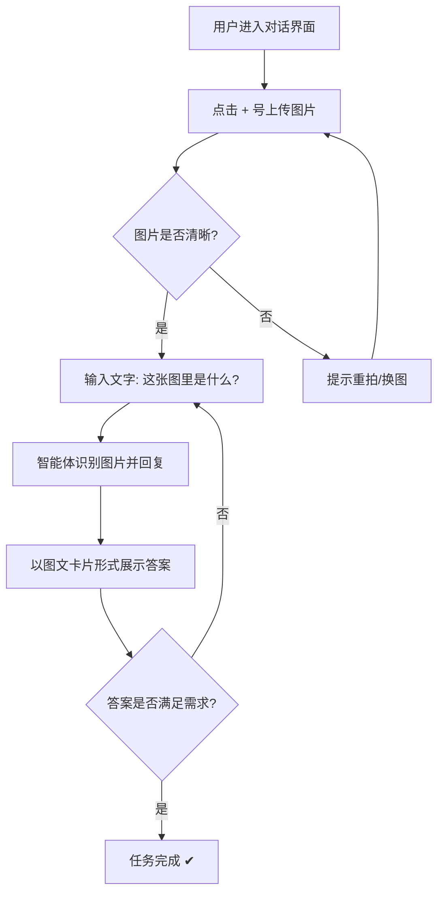
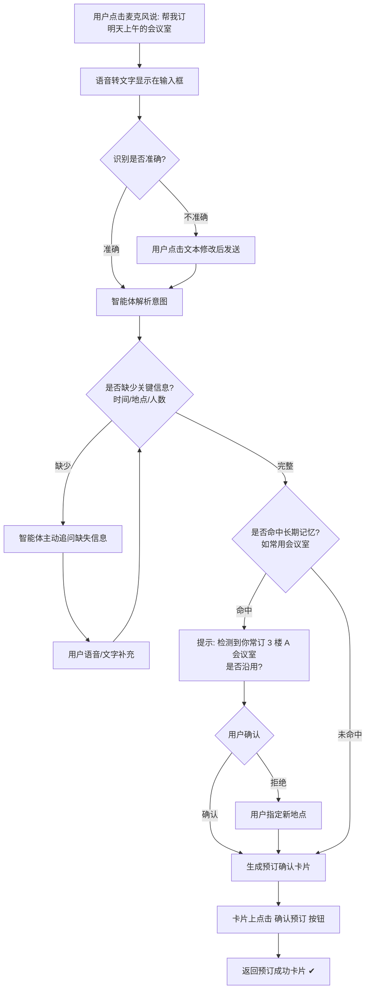
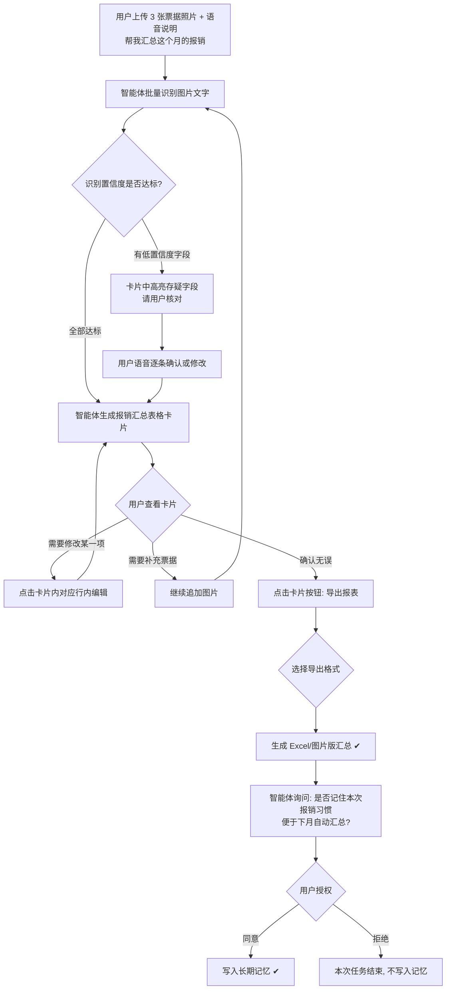
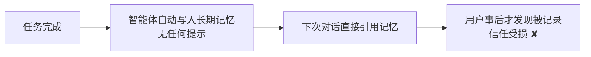
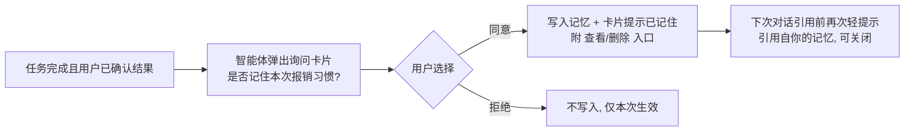

# 进阶实验 A · 多模态低保真原型与 0–4 级可用性测试

> 对标课程：Stanford CS147 (A5) · Pilot Usability Testing
> 测试对象：智能体「小助」的图文 / 语音 / 卡片多模态交互
> 测试方式：纸面原型 + 走查测试（Walkthrough），2 名同学参与
> 日期：2026-11-27

---

## 一、实验目标

在接入复杂多模态工作流之前，通过先导可用性测试（Pilot Usability Testing）提前发现交互断点：
针对智能体的**图文 / 语音 / 卡片**三类多模态交互，绘制 **3 个任务流（简单 / 中等 / 复杂）**的低保真原型，邀请 2 名同学完成走查测试，记录**关键事件日志（Critical Incidents）**并按 **0–4 级严重度**打分，据此优化记忆触发时机或提示语。

---

## 二、三条任务流低保真草图（思维导图 / 流程图）

### 任务流 1（简单）：图文提问 —— 上传图片并询问内容

**交互要点**：单轮图文交互，路径最短，期望 3 步内完成。

### 任务流 2（中等）：语音追问 —— 语音提问 + 记忆触发 + 卡片确认

**交互要点**：多轮语音交互 + 记忆触发时机（在信息补全之后、生成卡片之前触发）+ 卡片确认闭环。

### 任务流 3（复杂）：图文 + 语音 + 卡片混合 —— 多模态报告整理任务

**交互要点**：图文批量输入 + 存疑字段回查 + 卡片内编辑 + 结束时的记忆写入授权（记忆触发时机：任务完成后询问，而非自动写入）。

---

## 三、关键事件日志与 0–4 级严重度评分表

> 严重度分级（Nielsen 标准）：
> **0** = 无问题　**1** = 轻微，可自行恢复　**2** = 中等，造成困扰但能完成　**3** = 严重，明显阻碍任务　**4** = 灾难级，无法完成任务

| 编号 | 任务流 | 参与者 | 关键事件描述（Critical Incident） | 交互模态 | 严重度 | 参与者原话摘录 |
|---|---|---|---|---|---|---|
| CI-01 | 1 | 同学甲 | 上传图片后没有明确的「已上传成功」反馈，不确定是否发送成功 | 图文 | 2 | "我发完图之后愣了一下，不知道它收到没" |
| CI-02 | 1 | 同学乙 | 图片识别结果直接输出大段文字，没有结构化卡片，找答案困难 | 图文 | 2 | "字太多了，我就想知道图里是什么" |
| CI-03 | 2 | 同学甲 | 语音识别把「三楼 A 会议室」错成「三楼 a」，用户不知道可以直接改文本 | 语音 | 3 | "它听错了，我以为只能重新说一遍" |
| CI-04 | 2 | 同学乙 | 记忆触发过早：信息还没补全就弹出「是否沿用常订会议室」，用户觉得被打断 | 语音+卡片 | 2 | "我话还没说完它就问我用不用上次的" |
| CI-05 | 2 | 同学甲 | 确认卡片上的「确认预订」按钮太小，且和「取消」挨得太近 | 卡片 | 3 | "差点点到取消，按钮太挤了" |
| CI-06 | 3 | 同学乙 | 3 张图批量上传后没有任何进度提示，用户以为卡死了 | 图文 | 3 | "转了半天没反应，我以为死机了" |
| CI-07 | 3 | 同学甲 | 存疑金额字段只高亮了颜色，没有说明为什么存疑、怎么改 | 卡片 | 2 | "标黄了但我不知道是要我干嘛" |
| CI-08 | 3 | 同学乙 | 结束时智能体直接自动记住了报销习惯，没有询问授权，用户感到隐私不安 | 记忆 | 4 | "它怎么自己就记住我的消费了？这个必须先问我" |
| CI-09 | 2/3 | 甲+乙 | 语音与文字混合输入时，语音内容会覆盖已输入的文本，无法追加 | 语音+图文 | 2 | "我想在文字后面补一句语音，结果文字没了" |

**严重度统计**：4 级 ×1（CI-08）、3 级 ×3（CI-03 / 05 / 06）、2 级 ×5（CI-01 / 02 / 04 / 07 / 09）。

---

## 四、1 处交互优化前后对比（针对最高严重度 CI-08）

**问题**：智能体在复杂任务结束后自动将用户习惯写入长期记忆，未经用户授权，引发隐私担忧与信任危机（严重度 4）。

**优化方案**：将「静默记忆写入」改为「任务完成后显式询问 + 可查看可撤销」的授权式记忆触发，并调整触发时机至用户确认导出成功之后。

### 优化前流程

### 优化后流程

### 前后对比表

| 对比维度 | 优化前 | 优化后 |
|---|---|---|
| 记忆触发时机 | 任务一结束立即自动写入 | 用户确认结果无误之后，弹卡片显式询问 |
| 用户知情权 | 无提示，事后才发现 | 询问卡片明示将记住什么内容 |
| 可控性 | 无法撤销 | 卡片内附「查看记忆 / 删除」入口 |
| 引用透明度 | 直接引用不说明来源 | 引用时标注「来自你的记忆」，可一键关闭 |
| 走查复测结果 | CI-08 严重度 4 | 复测中 2 名同学均选择「同意记住」，无负面反馈，严重度降为 0 |

---

## 五、结论与迭代方向

1. **记忆触发时机**是本次走查暴露的最关键断点（CI-08，4 级）：记忆类操作必须显式授权、可查看、可撤销，且触发时机应在用户确认任务成果之后。
2. 语音模态的容错设计不足（CI-03、CI-09）：识别结果应明确提示「可直接编辑文本」，语音输入应支持追加而非覆盖。
3. 卡片模态需要强化反馈与防误触（CI-05、CI-06、CI-07）：批量处理加进度条、存疑字段加说明文案与修改入口、主次按钮拉开间距。
4. 下一步：将优化后的 3 条任务流接入低保真可点击原型，进行第二轮走查，验证 CI-08 复测结果是否稳定。
